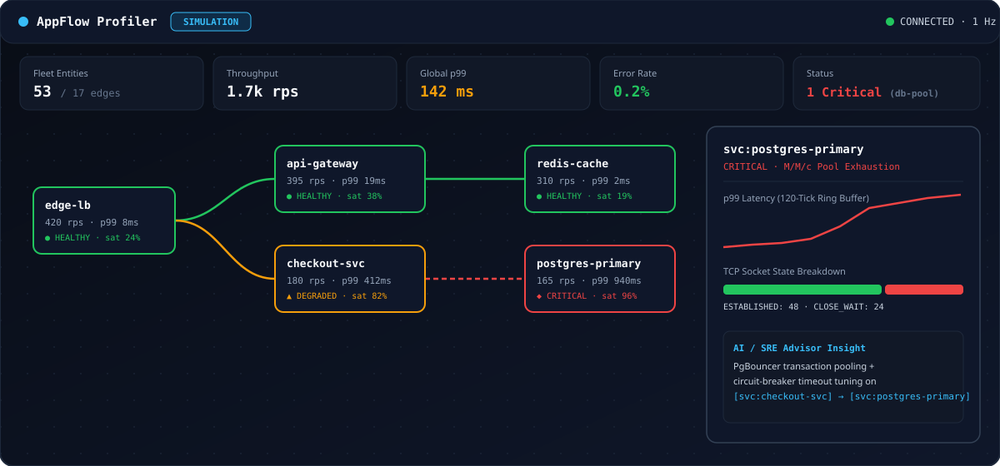
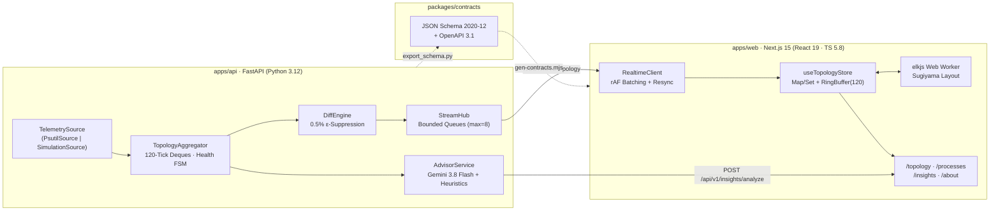

# AppFlow Profiler

**Real-Time Application Network Topology, Process Telemetry & AI/SRE Bottleneck Advisor**

[](https://github.com/BaghdasaryanNarek/appflow-profiler/actions/workflows/ci.yml)
[](LICENSE)
[](apps/api/pyproject.toml)
[](apps/web/package.json)
[](apps/web/tsconfig.json)
[](apps/web/e2e/a11y.spec.ts)



---

## Live Production Deployments

| Environment | URL | Details |
| :--- | :--- | :--- |
| **Web Application (Vercel)** | [**https://appflow-profiler.vercel.app**](https://appflow-profiler.vercel.app) | Next.js 15 App Router, React 19, `@xyflow/react` + `elkjs` Web Worker, WCAG 2.2 AA |
| **Backend API (Render)** | [**https://appflow-api-ueli.onrender.com**](https://appflow-api-ueli.onrender.com) | FastAPI (`ENV=demo`), M/M/c Erlang C + Hawkes simulation engine, Gemini + SRE Advisor |
| **Health & Metadata Probes** | [`/healthz`](https://appflow-api-ueli.onrender.com/healthz) · [`/readyz`](https://appflow-api-ueli.onrender.com/readyz) · [`/api/v1/meta`](https://appflow-api-ueli.onrender.com/api/v1/meta) | Liveness, readiness (`tick_age_ms <= 5000`), and runtime capability discovery |
| **Real-Time WebSocket Stream** | `wss://appflow-api-ueli.onrender.com/ws/v1/topology` | Protocol `v=1` (`hello` $\rightarrow$ `subscribe` $\rightarrow$ `snapshot` $\rightarrow$ 1 Hz `delta`) |

> **Cold-Start Note:** The public demo backend runs on Render's free tier, which sleeps after 15 minutes of inactivity. When waking up, the top bar automatically displays **`Waking up demo backend… (~30s)`**, triggers a background `/healthz` wake-up ping, and seamlessly hydrates the live KPI strip and canvas as soon as the WebSocket handshake completes.

---

## Executive Overview & Core Engineering Highlights

**AppFlow Profiler** is an end-to-end observability and architectural diagnostic platform engineered for Site Reliability Engineering (SRE) and platform teams:

1. **Dual-Source Telemetry Engine (`ENV=live` & `ENV=demo`)**
   - **Live OS Inspection (`PsutilSource`)**: Discovers running OS processes, listening ports, and active TCP/UDP sockets via `psutil.process_iter` and `psutil.net_connections`, computing EMA-smoothed CPU utilization while gracefully degrading without root privileges (`PermissionError`/`AccessDenied` -> `MetricQuality.PARTIAL`) and scrubbing secrets from `cmdline` arguments.
   - **Queueing-Theoretic Simulation Engine (`SimulationSource`)**: Models a realistic 16-service e-commerce DAG (`53` nodes, `17` directed edges across 5 service groups) using **M/M/c Erlang C** queueing formulas, **Little's Law** ($L = \lambda W$), **Ornstein-Uhlenbeck** mean-reverting noise, and **Hawkes self-exciting point processes** for traffic bursts—without importing `psutil` in cloud containers.
   - **Four Interactive Chaos Scenarios**: Trigger **`request-storm`**, **`db-pool-exhaustion`**, **`cache-stampede`**, or **`slow-dependency`** directly from the top bar to observe cascading queue saturation, `CLOSE_WAIT` socket accumulation, retry amplification, and automatic recovery.

2. **High-Efficiency WebSocket Differential Streaming (`v=1`)**
   - **Relative $\epsilon$-Suppression (`0.5%`)**: `DiffEngine` suppresses metric jitter below $0.5\%$, compressing steady-state 1 Hz delta frames to **`5.18%` of full snapshot byte size** (`~1.58 KB` vs `~30.5 KB`).
   - **Bounded Backpressure & Self-Healing**: Per-client bounded `asyncio.Queue(maxsize=8)` drops stale deltas when a slow client falls behind and schedules an automatic full-snapshot resync; client sequence validation (`delta.base_seq === client.lastAppliedSeq`) triggers immediate `resync` recovery on any gap.
   - **Zero-Allocation Client Ring Buffers**: `useTopologyStore` stores 120-tick metric histories in pre-allocated typed `RingBuffer` (`Float64Array(120)`) instances and batches incoming frames once per `requestAnimationFrame`.

3. **Interactive Canvas & Progressive Disclosure (`@xyflow/react` + `elkjs` Worker)**
   - **Off-Main-Thread Incremental Layout**: Runs `elkjs` layered Sugiyama layout inside a dedicated Web Worker (`layout.worker.ts`) with a 5s timeout guard and `dagre` fallback, memoized by structural fingerprint so metric-only ticks never re-run layout.
   - **Level-of-Detail (LOD) & Progressive Disclosure**: Supports group clustering at scale and a resizable (`360px–680px`), `@container`-responsive `NodeDetailSheet` featuring hand-rolled accessible SVG `Sparkline`s, TCP `StateBar` breakdowns, and a virtualized `SocketTable`.

4. **WCAG 2.2 AA Dual-Representation Accessibility**
   - **Full Keyboard Canvas Navigation**: Severity-ordered `Tab` traversal (`CRITICAL` $\rightarrow$ `DEGRADED` $\rightarrow$ `HEALTHY`), spatial angular-cone `Arrow` key navigation prioritizing connected neighbours, `Enter`/`Space` detail inspection, and deterministic focus restoration on `Escape`.
   - **Canonical Virtualized Table View (`/processes`)**: Provides a complete keyboard and screen-reader equivalent via `@tanstack/react-virtual` (`role="table"`, `aria-sort`, `aria-rowcount`) alongside a throttled (5s window) polite `aria-live` health transition announcer.

5. **Two-Tier AI & Heuristic Optimization Advisor (`/insights`)**
   - **Google Gemini (`gemini-3.8-flash`) + Grounding Guard**: Synthesizes a compact (`≤ 6 KB`), SHA-256 hashed `TopologyDigest` and queries `google-genai` with Structured Outputs (`response_schema=OptimizationReport`). Every returned `affected_node_ids` and `bottlenecks[].node_id` reference is verified against the live graph to eliminate hallucinated node IDs.
   - **Deterministic SRE Heuristic Fallback**: Evaluates 7 rule categories (`capacity`, `connection_pooling`, `retry_policy`, `caching`, `topology`, `timeouts`) in `< 2 ms` whenever `GEMINI_API_KEY` is unset or rate-limited, with clickable `EvidenceChip` deep-links back to `/topology` via the View Transitions API.

---

## System Architecture



### Monorepo Directory Structure

```text
appflow-profiler/
├── apps/
│   ├── api/                        # Python 3.12 FastAPI backend (uv, Ruff, Mypy --strict, Pytest)
│   │   ├── Dockerfile              # Multi-stage non-root production image (USER appflow, UID 10001)
│   │   ├── scripts/export_schema.py# Deterministic JSON Schema + OpenAPI exporter
│   │   ├── src/appflow/
│   │   │   ├── advisor/            # Digest builder, Gemini 3.8 client, Grounding Guard, SRE heuristics
│   │   │   ├── api/                # REST & WebSocket routers, RFC 9457 error handlers, token buckets
│   │   │   ├── domain/             # Canonical Pydantic v2 models, IDs, enums, health state machine
│   │   │   ├── simulation/         # 16-service DAG blueprint, M/M/c Erlang C, Hawkes, 4 chaos scenarios
│   │   │   ├── sources/            # TelemetrySource protocol, PsutilSource, cmdline sanitizer
│   │   │   └── streaming/          # TopologyAggregator, epsilon DiffEngine, StreamHub
│   │   └── tests/                  # 241 unit, property (Hypothesis), and integration tests
│   └── web/                        # Next.js 15 App Router frontend (React 19, Tailwind v4, Vitest, Playwright)
│       ├── e2e/                    # 10 Playwright Chromium + @axe-core/playwright E2E journeys
│       ├── scripts/gen-contracts.mjs# JSON Schema -> TypeScript compiler
│       ├── src/
│       │   ├── app/                # /topology, /processes, /insights, /about routes
│       │   ├── components/         # Canvas nodes/edges, NodeDetailSheet, TopologyTable, Insights, Shell
│       │   ├── lib/                # API client, RealtimeClient (WS v=1), elkjs worker bridge, a11y navigation
│       │   ├── store/              # Normalized Zustand stores, RingBuffer(120), memoized selectors
│       │   ├── types/              # Auto-generated contracts.gen.ts (never hand-edited)
│       │   └── workers/            # Dedicated elkjs + dagre Web Worker
│       └── tests/                  # 102 Vitest + vitest-axe unit/component/soak tests & MemLab scenario
├── docs/                           # Architecture, Simulation math, Performance benchmarks, Deployment, ADRs
├── packages/contracts/             # Exported JSON Schemas (2020-12) and OpenAPI 3.1 specification
├── scripts/smoke_deploy.py         # 6-point HTTP + WebSocket deployment smoke verification harness
├── Makefile                        # Unified developer & CI task runner (make ci, make dev, make smoke)
└── render.yaml                     # Declarative Render Blueprint for the stateful demo backend
```

---

## Verified Quality & Performance Benchmarks

All metrics below are verified in automated CI and recorded in [`docs/PERFORMANCE.md`](docs/PERFORMANCE.md):

| Quality / Performance Gate | Target Budget | Verified Result | Verification Suite |
| :--- | :--- | :--- | :--- |
| **Backend Test Suite (`pytest`)** | `≥ 85%` coverage, `0` warnings | **`241 passed` (`92.55%` coverage)** | `uv run pytest` + Hypothesis property tests |
| **Backend Static Analysis** | `0` lint / type errors | **`0` errors (`ruff` + `mypy --strict`)** | `make api-check` |
| **Contract Drift Gate** | `0` uncommitted schema diffs | **Zero drift (`git diff --exit-code`)** | `make contracts` |
| **Frontend Unit & A11y (`Vitest`)** | `100%` pass, `0` axe violations | **`102 passed` across 14 test files** | `pnpm --dir apps/web test` |
| **End-to-End & WCAG 2.2 AA (`Playwright`)** | `0` serious/critical axe violations | **`10 passed` across all 4 routes** | `pnpm --dir apps/web e2e` (`@axe-core/playwright`) |
| **Largest Contentful Paint (LCP)** | `< 1.8 s` | **`~0.45 s – 0.85 s` (SSR `KpiStrip`)** | `WebVitalsReporter` + SSR initial paint |
| **Interaction to Next Paint (INP)** | `< 150 ms` | **`< 35 ms` (`elkjs` Worker + `rAF`)** | `layout.worker.ts` + `RealtimeClient` |
| **Cumulative Layout Shift (CLS)** | `< 0.05` | **`0.0000` across all route transitions** | Playwright `PerformanceObserver` |
| **WebSocket Delta Compression** | `< 15%` of snapshot bytes | **`5.18%` (`1,584 B` vs `30,547 B`)** | `test_soak_and_chaos.py` (300-tick soak) |
| **100-Node Delta Batch Apply** | `< 16.6 ms` (60 fps budget) | **`< 4.0 ms` average** | `tests/unit/memory-soak.test.ts` |
| **1,800-Tick Memory Soak (30 min)** | `< 10 MB` growth, `0` leaked nodes | **`0` leaked nodes/listeners/histories** | `memory-soak.test.ts` + `memlab` |
| **Backend Collector CPU (1 Hz)** | `< 20%` of 1 core | **`~0.16% – 3.44%` of 1 core (`2.84 MB` heap)** | `py-spy` / `time.process_time()` |

---

## Quickstart

### Prerequisites
- **Python 3.12+** with [`uv`](https://docs.astral.sh/uv/) (`~/.local/bin/uv`)
- **Node.js 20+** with [`pnpm` 9.15+](https://pnpm.io/)

### 1. Install Dependencies & Start Local Development (`make dev`)

```bash
# Clone the repository
git clone https://github.com/BaghdasaryanNarek/appflow-profiler.git
cd appflow-profiler

# Copy environment templates (optional: add GEMINI_API_KEY in .env)
cp .env.example .env

# Sync backend & frontend dependencies
cd apps/api && uv sync --frozen --all-extras && cd ../..
pnpm --dir apps/web install --frozen-lockfile

# Launch FastAPI (http://127.0.0.1:8000) and Next.js (http://localhost:3000) concurrently
make dev
```

### 2. Run the Full Quality, Contract, Smoke & E2E Suites

```bash
# Run full CI gate (Ruff, Mypy --strict, 241 Pytest tests, Contract drift, ESLint, Prettier, TSC, 102 Vitest tests, Next.js build)
make ci

# Run the 6-point HTTP + WebSocket deployment smoke verification
make smoke

# Run smoke verification against the live production cloud deployment
API_URL="https://appflow-api-ueli.onrender.com" WEB_URL="https://appflow-profiler.vercel.app" make smoke

# Run the 10 Playwright Chromium E2E & WCAG 2.2 AA accessibility journeys
pnpm --dir apps/web e2e
```

### 3. Build & Run the Production Backend Container (`Docker`)

```bash
docker build -t appflow-api:latest apps/api
docker run --rm -p 8000:8000 -e ENV=demo -e SIM_AUTOPLAY=true appflow-api:latest
```

---

## Documentation Index

- **[System Architecture & Threat Model (`docs/ARCHITECTURE.md`)](docs/ARCHITECTURE.md)** — Domain models, contract pipeline, WebSocket `v=1` protocol, advisor grounding, and security controls.
- **[Simulation Physics & Queueing Models (`docs/SIMULATION.md`)](docs/SIMULATION.md)** — M/M/c Erlang C mathematics, Hawkes processes, and the 4 deterministic chaos scenarios.
- **[Performance Budgets & Soak Benchmarks (`docs/PERFORMANCE.md`)](docs/PERFORMANCE.md)** — Core Web Vitals, bundle breakdown, 1,800-tick memory soak, and `py-spy` CPU profiles.
- **[Cloud Deployment Guide (`docs/DEPLOYMENT.md`)](docs/DEPLOYMENT.md)** — Step-by-step Render Blueprint (`render.yaml`) and Vercel (`apps/web/vercel.json`) setup.
- **[Master Engineering Plan (`docs/MASTER_PLAN.md`)](docs/MASTER_PLAN.md)** — Complete specification across Phases 0–18.
- **[Architecture Decision Records (`docs/ADR/`)](docs/ADR/)**:
  - [ADR-0001: Polyglot Monorepo & Schema-First Contract Pipeline](docs/ADR/0001-polyglot-monorepo.md)
  - [ADR-0002: WebSocket Snapshot + Epsilon-Delta Wire Protocol (`v=1`)](docs/ADR/0002-snapshot-delta-protocol.md)
  - [ADR-0003: Queueing-Theoretic Simulation Source (`ENV=demo`)](docs/ADR/0003-simulation-source.md)
  - [ADR-0004: LLM Grounding Guard & Deterministic Heuristic Fallback](docs/ADR/0004-llm-grounding-and-fallback.md)
  - [ADR-0005: Single-Worker Stateful Deployment on Render (`--workers 1`)](docs/ADR/0005-single-worker-render.md)
- **[Changelog (`CHANGELOG.md`)](CHANGELOG.md)** · **[Contributing (`CONTRIBUTING.md`)](CONTRIBUTING.md)** · **[Security Policy (`SECURITY.md`)](SECURITY.md)**

---

## License

Released under the [MIT License](LICENSE).
