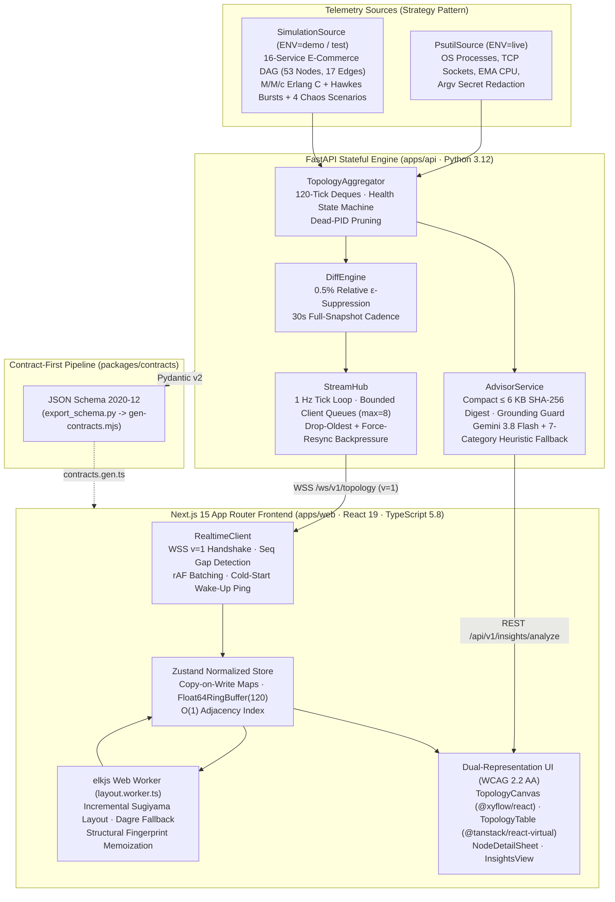
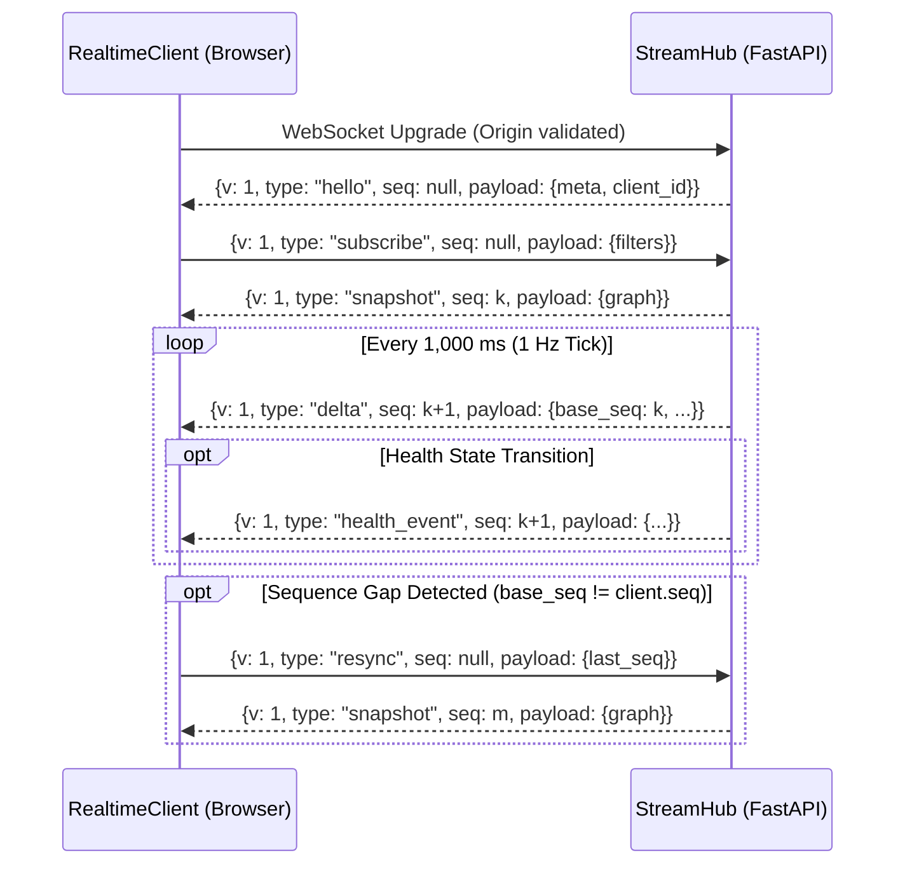

# AppFlow Profiler — System Architecture & Engineering Reference

**AppFlow Profiler** is a real-time application network topology, operating system process telemetry, and AI/SRE bottleneck diagnostic platform. This document provides the authoritative architectural reference for the domain models, contract generation pipeline, WebSocket differential wire protocol (`v=1`), memory bounds, and security threat model.

---

## 1. End-to-End System Topology

---

## 2. Polyglot Monorepo & Single Source of Truth Contracts

All REST and WebSocket payloads are defined once as strict **Pydantic v2** models (`extra="forbid"`, `frozen=True`) inside [`apps/api/src/appflow/domain/models.py`](../apps/api/src/appflow/domain/models.py), [`apps/api/src/appflow/streaming/protocol.py`](../apps/api/src/appflow/streaming/protocol.py), and [`apps/api/src/appflow/advisor/models.py`](../apps/api/src/appflow/advisor/models.py).

### Contract Synchronization Pipeline (`make contracts`)

1. **`apps/api/scripts/export_schema.py`**: Exports deterministic JSON Schema (Draft 2020-12) files into [`packages/contracts/`](../packages/contracts/) (`topology.schema.json`, `ws-protocol.schema.json`, `advisor.schema.json`, `problem.schema.json`, `openapi.json`).
2. **`apps/web/scripts/gen-contracts.mjs`**: Compiles the JSON Schemas into [`apps/web/src/types/contracts.gen.ts`](../apps/web/src/types/contracts.gen.ts) with an `@generated` banner.
3. **CI Drift Gate (`contracts` job)**: Runs `make contracts` and asserts `git diff --exit-code packages/contracts apps/web/src/types`, guaranteeing zero schema drift between Python and TypeScript.

### Toolchain Pins & Dependency Updates

- **Node.js 24**: declared once in `engines.node` (`"24.x"`) of [`apps/web/package.json`](../apps/web/package.json), which both Vercel and CI (`actions/setup-node` with `node-version-file`) read. The root `.nvmrc` mirrors the major for nvm/fnm users.
- **pnpm 12.14.0**: declared once in `packageManager` of `apps/web/package.json`, which CI (`pnpm/action-setup` with `package_json_file`) and local pnpm read. pnpm 12 records its own resolution and integrity in a leading document of `pnpm-lock.yaml`.
- [`apps/web/tests/unit/toolchain.test.ts`](../apps/web/tests/unit/toolchain.test.ts) fails if the pins drift or become ranges, or if pnpm-owned files lose their [`.prettierignore`](../apps/web/.prettierignore) entry.
- **Dependabot** (`uv` for `apps/api`, `npm` for `apps/web`, `github-actions`) groups minor and patch updates into one PR per ecosystem and opens majors separately. The workflow is in [`CONTRIBUTING.md`](../CONTRIBUTING.md#4-dependency-updates).

---

## 3. Domain Model & Deterministic Health State Machine

### 3.1 Canonical Identifiers
Every entity uses a deterministic, human-readable identifier prefix (`apps/api/src/appflow/domain/ids.py`):
- `svc:<name>` — Logical microservice or clustered application tier (e.g., `svc:api-gateway`, `svc:postgres-primary`).
- `proc:<name>:<port|pid>` — Observed OS process vertex.
- `ext:<host>:<port>` — External third-party dependency endpoint (e.g., `ext:payments-provider`).
- `edge:<source_id>-><target_id>:<protocol>` — Directed communication edge between two vertices.
- `grp:<name>` — Architectural tier or process group (`grp:edge`, `grp:core`, `grp:data`, `grp:async`, `grp:external`).

### 3.2 Multi-Signal Health Evaluation (`apps/api/src/appflow/domain/health.py`)
Health states (`healthy`, `degraded`, `critical`, `unknown`) are computed deterministically on every tick along with human-readable `health_reasons`:

| Signal | `healthy` | `degraded` | `critical` |
| :--- | :--- | :--- | :--- |
| **Error Rate (`error_rate`)** | `< 1.0%` | `1.0% – 5.0%` | `≥ 5.0%` |
| **Saturation (`saturation`)** | `< 75%` | `75% – 90%` | `≥ 90%` |
| **Tail Latency (`p99_ms`)** | `< 250 ms` | `250 ms – 1,000 ms` | `≥ 1,000 ms` |
| **CPU Utilization (`cpu_pct`)** | `< 80%` | `80% – 95%` | `≥ 95%` |
| **Socket Leaks (`CLOSE_WAIT`)** | `< 5` | `5 – 19` | `≥ 20` |

---

## 4. WebSocket Differential Streaming Protocol (`v=1`)

Endpoint: `WS /ws/v1/topology` (envelope version `v: 1`).

### 4.1 Wire Frame Lifecycle

### 4.2 Bandwidth & Backpressure Controls
- **Relative $\epsilon$-Suppression (`0.5%`)**: `DiffEngine` suppresses metric updates where $|v_{\text{new}} - v_{\text{old}}| / \max(|v_{\text{old}}|, 10^{-6}) < 0.005$ and health is unchanged, reducing steady-state frame size to **`5.18%` of snapshot byte size** (`~1.58 KB` vs `~30.5 KB`).
- **Bounded Per-Client Queues (`maxsize=8`)**: Each connected WebSocket client has an isolated `asyncio.Queue(maxsize=8)`. If a slow client fills its queue, `StreamHub` drops stale queued deltas and marks the client for an immediate full `snapshot` on its next drain cycle—never blocking the global collector loop.
- **Single-`requestAnimationFrame` Client Batching**: `RealtimeClient` buffers incoming frames and flushes them into `useTopologyStore` at most once per animation frame (`16.6 ms`), pausing DOM updates when `document.visibilityState === "hidden"`.

---

## 5. Two-Tier AI & Heuristic Optimization Advisor

Endpoint: `POST /api/v1/insights/analyze`

1. **Compact Topology Digest (`≤ 6 KB`)**: `build_topology_digest()` ranks nodes and edges by a composite anomaly score (severity weight + saturation + error rate + normalized p99 latency) and serializes the top 25 nodes and top 30 edges into a canonical JSON digest hashed with SHA-256 (`digest_hash`).
2. **Tier 1 — Google Gemini (`gemini-3.8-flash`)**: Invokes `google-genai` with `response_schema=OptimizationReport`, `temperature=0.2`, and an `asyncio.Lock` + TTL cache keyed by `(digest_hash, scope, focus)`.
3. **Grounding Guard**: Every `evidence_ids` reference returned by Gemini is verified against the active `TopologyGraph`. Any hallucinated node or edge ID is stripped; recommendations left with zero valid evidence IDs are discarded, falling back to the heuristic engine if needed.
4. **Tier 2 — Deterministic SRE Heuristic Engine**: Evaluates 7 production rule categories (`saturation`, `connection_pooling`, `retry_amplification`, `caching`, `latency`, `timeouts`, `capacity`) in `< 2 ms` whenever `GEMINI_API_KEY` is unset, rate-limited, or times out.

---

## 6. Security & Threat Model

| Control Domain | Implementation |
| :--- | :--- |
| **Secret Redaction (`sanitize.py`)** | Process `cmdline` arguments are scrubbed via regex (`--password`, `--token`, `--secret`, `--api-key`, `Bearer`, DSN credentials, `AWS_SECRET`, `PRIVATE_KEY`) and truncated to 256 chars before leaving `PsutilSource`. Environment variables (`proc.environ()`) are never read. |
| **Strict API Key Isolation** | `GEMINI_API_KEY` is read exclusively by `apps/api/src/appflow/config.py` (`SecretStr`) on the server and is never exposed in `/api/v1/meta`, client bundles, or logs. |
| **CORS & WebSocket Origin Validation** | Both HTTP middleware and `/ws/v1/topology` validate the `Origin` header against `ALLOWED_ORIGINS` and `ALLOWED_ORIGIN_SUFFIXES` (`.vercel.app`), rejecting untrusted WebSocket handshakes with code `1008`. |
| **RFC 9457 Problem Details** | All HTTP `4xx`/`5xx` responses return `application/problem+json` with `type`, `title`, `status`, `detail`, `instance`, and `correlation_id`—never raw stack traces. |
| **Container & Header Hardening** | `apps/api/Dockerfile` runs as non-root `USER appflow` (`UID 10001`). `apps/web/next.config.ts` and `vercel.json` enforce `Content-Security-Policy`, `X-Content-Type-Options: nosniff`, `X-Frame-Options: DENY`, `Referrer-Policy`, and `Permissions-Policy`. |

---

## 7. Architecture Decision Records (ADRs)

- [ADR-0001: Polyglot Monorepo & Schema-First Contracts](ADR/0001-polyglot-monorepo.md)
- [ADR-0002: WebSocket Snapshot + Epsilon-Delta Protocol](ADR/0002-snapshot-delta-protocol.md)
- [ADR-0003: Queueing-Theoretic Simulation Source](ADR/0003-simulation-source.md)
- [ADR-0004: LLM Grounding Guard & Deterministic Heuristic Fallback](ADR/0004-llm-grounding-and-fallback.md)
- [ADR-0005: Single-Worker Stateful Deployment on Render](ADR/0005-single-worker-render.md)
