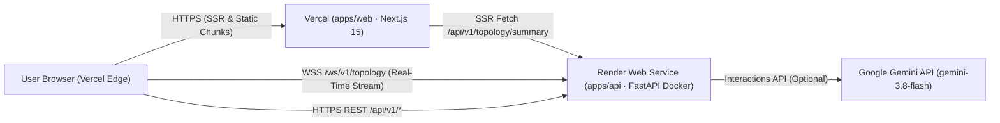

# AppFlow Profiler — Cloud Deployment Guide (Render + Vercel)

This guide covers deploying **AppFlow Profiler** to production using **Render** (for the stateful FastAPI + WebSocket simulation/telemetry daemon) and **Vercel** (for the Next.js 15 App Router frontend), as specified in Master Plan §5.5, §6.4, and Phase 17.

---

## 1. Deployment Topology Overview



### Key Architectural Invariants
1. **Single-Worker Stateful Process (`--workers 1`)**:
   - The simulation engine (`SimulationEngine`), ring-buffer history (`TopologyAggregator`), and WebSocket subscriber queues (`StreamHub`) live in-process. `apps/api/Dockerfile` and `render.yaml` explicitly enforce `--workers 1` and `numInstances: 1` so all connected clients observe a unified timeline and shared chaos scenario state.
2. **Zero `psutil` Dependency in Cloud Demo Mode (`ENV=demo`)**:
   - When `ENV=demo`, `build_source()` instantiates `SimulationSource` without importing `psutil`, making the container completely portable across restricted PaaS sandboxes.
3. **Cold-Start Resilience (`~30s` Render Free Tier)**:
   - When a sleeping Render free-tier instance receives a connection request after 15 minutes of inactivity, `RealtimeClient` transitions the UI indicator to **`Waking up demo backend… (~30s)`**, triggers an HTTP `GET /healthz` wake-up request, and retries with exponential backoff + full jitter (`min(30s, 0.5s * 2^n) ± 20%`).

---

## 2. Step-by-Step Backend Deployment on Render (`render.yaml`)

The repository root includes a declarative Render Blueprint ([`render.yaml`](../render.yaml)) and a hardened multi-stage [`apps/api/Dockerfile`](../apps/api/Dockerfile) running as non-root user `appflow` (`UID 10001`).

### Steps
1. Sign in to the **Render Dashboard** and click **New + $\rightarrow$ Blueprint**.
2. Connect the GitHub repository (`BaghdasaryanNarek/appflow-profiler`) on branch `main`.
3. Render will automatically detect `render.yaml` and configure the `appflow-api` service:
   - **Runtime**: `docker` (`rootDir: apps/api`, `dockerfilePath: ./Dockerfile`)
   - **Health Check Path**: `/healthz`
   - **Auto-Deploy Trigger**: `checksPass` (deploys only after GitHub Actions CI passes)
4. When prompted for unsynced secret environment variables (`sync: false`), enter:
   - `GEMINI_API_KEY`: Your Google Gemini API key (or leave blank to run with the deterministic heuristic advisor fallback).
5. Click **Apply** and wait for the build to complete. Copy the public Render service URL (e.g., `https://appflow-api.onrender.com`).

### Backend Environment Variables (`apps/api/.env.example`)

| Variable | Render Blueprint Value | Purpose |
| :--- | :--- | :--- |
| `ENV` | `demo` | Activates the deterministic M/M/c + Hawkes simulation engine |
| `SIM_AUTOPLAY` | `true` | Cycles through the 4 chaos scenarios automatically every 4 minutes |
| `TICK_MS` | `1000` | 1 Hz telemetry sampling and differential broadcast cadence |
| `SNAPSHOT_EVERY_S` | `30` | Periodic full-graph reconciliation interval |
| `MAX_WS_CLIENTS` | `50` | Maximum concurrent WebSocket connections |
| `ALLOWED_ORIGINS` | `http://localhost:3000,http://127.0.0.1:3000,https://appflow-profiler.vercel.app` | Exact allowed Origins for CORS and WebSocket upgrade checks |
| `ALLOWED_ORIGIN_SUFFIXES` | `.vercel.app` | Permits HTTPS Vercel preview deployment URLs (`https://*.vercel.app`) |
| `GEMINI_API_KEY` | *(Secret / Optional)* | Enables live Gemini `gemini-3.8-flash` architectural reports |
| `GEMINI_MODEL` | `gemini-3.8-flash` | Target Gemini model identifier |
| `ADVISOR_TIMEOUT_S` | `25` | Timeout before graceful fallback to heuristic advisor |
| `LOG_LEVEL` | `INFO` | Structured JSON logging level |

---

## 3. Step-by-Step Frontend Deployment on Vercel (`apps/web`)

The frontend includes [`apps/web/vercel.json`](../apps/web/vercel.json) and security headers in [`apps/web/next.config.ts`](../apps/web/next.config.ts) (`X-Content-Type-Options: nosniff`, `X-Frame-Options: DENY`, `Referrer-Policy: strict-origin-when-cross-origin`, `Permissions-Policy`, and `Content-Security-Policy`).

### Steps
1. Sign in to **Vercel** and click **Add New… $\rightarrow$ Project**.
2. Import the `BaghdasaryanNarek/appflow-profiler` GitHub repository.
3. Set **Root Directory** to `apps/web`.
4. Confirm Framework Preset is **Next.js** and Install Command is `pnpm install --frozen-lockfile`.
5. Configure the following **Environment Variables** (for Production, Preview, and Development):
   - `NEXT_PUBLIC_API_URL`: `https://<your-render-service>.onrender.com`
   - `NEXT_PUBLIC_API_BASE_URL`: `https://<your-render-service>.onrender.com`
   - `NEXT_PUBLIC_WS_URL`: `wss://<your-render-service>.onrender.com/ws/v1/topology`
6. Click **Deploy**.
7. Once deployed, verify that your production Vercel domain matches `ALLOWED_ORIGINS` in Render (all `https://*.vercel.app` production and PR preview URLs are automatically permitted via `ALLOWED_ORIGIN_SUFFIXES=.vercel.app`).

---

## 4. Post-Deployment Smoke Verification (`make smoke`)

Run the automated 6-point smoke check suite locally or in CI via:

```bash
make smoke
```

The smoke script ([`scripts/smoke_deploy.py`](../scripts/smoke_deploy.py)) validates:
1. `GET /healthz` returns `200 OK` (`{"status": "ok"}`).
2. `GET /readyz` returns `200 OK` (`source_ready: true`, `tick_age_ms <= 5000`).
3. `GET /api/v1/meta` returns `200 OK` with expected `version` and `mode`.
4. `GET /api/v1/topology/summary` returns `200 OK` with `node_count > 0` and `Cache-Control` header.
5. `WS /ws/v1/topology` completes the `hello` + `subscribe` $\rightarrow$ `snapshot` (`seq >= 1`) handshake.
6. `POST /api/v1/insights/analyze` returns `200 OK` with a grounded `OptimizationReport`.
