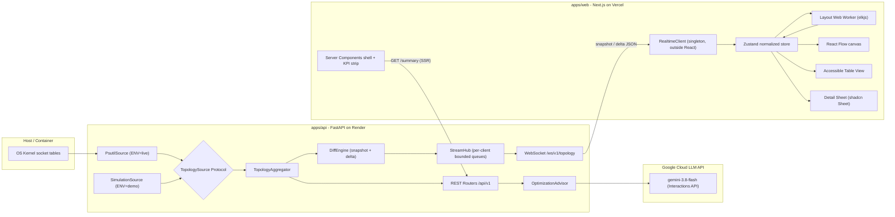
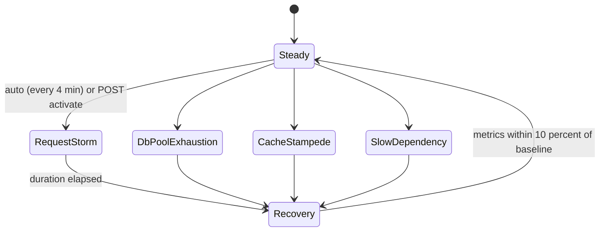

# AppFlow Profiler — Master Architecture Document (v1.0)

> **Audience:** The Senior Developer AI Agent who will implement this system phase by phase.
> **Author role:** Principal Staff Engineer / Chief DevOps Architect / UI-UX Director.
> **Rule zero:** This document is the single source of truth. If an implementation detail is not specified here, choose the simplest option that keeps CI green and the contracts below intact. Do not invent new top-level features.

---

## 0. Architect's Pre-Flight Analysis

Here are the constraints and the design decisions that come from them, so the agent knows why each decision was made.

| # | Constraint / Force | Architectural Decision |
|---|---|---|
| 1 | `psutil.net_connections()` needs elevated privileges on macOS and is blocked or meaningless inside PaaS containers (Render). | A **`TopologySource` Protocol** with two interchangeable implementations: `PsutilSource` (live) and `SimulationSource` (demo). Selected only by `ENV`, with no `if demo:` checks spread through business logic. |
| 2 | Thousands of nodes streamed at ~1 Hz will freeze React if every tick replaces the entire graph. | **Snapshot + Delta protocol** with monotonic sequence numbers. The client applies deltas into a **normalized Zustand store** (Maps keyed by ID) and batches them with `requestAnimationFrame`. Layout runs in a **Web Worker**. |
| 3 | Next.js + React Flow is client-heavy, so LCP is at risk. | A **Server Component shell** (header, KPI strip from REST `summary`) renders first and becomes the LCP element. The React Flow canvas is loaded with `next/dynamic` (`ssr: false`) behind a skeleton with fixed dimensions (CLS ≈ 0). |
| 4 | A canvas is inherently hostile to screen readers. | **Dual representation:** an accessible React Flow (focusable nodes and edges, ARIA labels, keyboard neighbour traversal) **plus** an equivalent semantic **Table View** of the same store data. Significant changes are announced through a throttled `aria-live` region. |
| 5 | AI features must use only cloud LLM APIs. | `google-genai` Python SDK (≥ 2.25.0), **Interactions API**, model `gemini-3.8-flash`, with **structured output** bound to a Pydantic schema. Only an **aggregated topology digest** is sent; raw command lines and arguments are never sent. A deterministic heuristic fallback is used when no API key is present, so the demo and CI never depend on network access. |
| 6 | "Green Checkmark Rule": CI must stay green from the very first push. | CI is introduced in **Phase 2**, before most features exist. Every phase ends with `make ci` passing locally before `git push`. Python ↔ TypeScript contract drift is detected in CI. |
| 7 | Public portfolio demo with a free Render tier (cold starts, idle sockets). | WS heartbeat every 15 s, client reconnect with exponential backoff + jitter, and a polished "Waking up demo backend…" UI state. A `render.yaml` blueprint hard-codes `ENV=demo`. |
| 8 | The rich Git history must be readable. | **Conventional Commits** with scopes (`api`, `sim`, `web`, `ci`, `docs`, `contracts`). Several atomic commits per phase, each with exact commands. |

**Monorepo shape decision:** Polyglot monorepo with `apps/api` (Python, managed by **uv**) and `apps/web` (Next.js, managed by **pnpm**). It also has `packages/contracts` holding the **JSON Schema generated from Pydantic**, which is the single cross-language source of truth. TypeScript types are generated from it, never hand-written.

**Hand-off protocol for the coding agent:** Implement phases strictly in order. Inside each phase, make one commit per bullet group as listed. Do not merge phases. If a phase's acceptance criteria are not met, fix the problem with a `fix(...)` commit inside the same phase before moving on.

---

## 1. Executive Summary & Architecture Flow

**AppFlow Profiler** is an enterprise-grade **network topology and observability dashboard** for SRE and platform teams. It discovers OS-level process-to-process and process-to-endpoint connections, aggregates them into a live service graph, and streams incremental updates over WebSockets. The graph is rendered in a high-performance React Flow canvas. An LLM-powered **Optimization Advisor** explains bottlenecks (connection-pool saturation, chatty fan-out, retry amplification, hot datastores) and proposes concrete infrastructure tuning.

### 1.1 Core capabilities

1. **Live Topology Map**: processes, services, datastores, queues and external endpoints as nodes; connections as edges weighted by throughput, latency and error rate.
2. **Progressive Disclosure**: a clean map by default. Clicking or pressing Enter on a node opens an animated slide-out sheet with PIDs, socket tables, state breakdowns (`ESTABLISHED`, `TIME_WAIT`, `CLOSE_WAIT`) and metric sparklines.
3. **Optimization Advisor (AI)**: an on-demand architectural report with prioritized, evidence-linked recommendations.
4. **Simulation Mode**: a deterministic, mathematically grounded microservice traffic simulator with scenario playback (request storms, DB pool exhaustion, cache stampede, slow downstream dependency).

### 1.2 System architecture



### 1.3 Runtime data flow (tick loop)

```mermaid
sequenceDiagram
    participant Src as TopologySource
    participant Agg as Aggregator
    participant Diff as DiffEngine
    participant Hub as StreamHub
    participant C as Browser Client
    participant St as Zustand Store

    C->>Hub: WS connect + subscribe(filters)
    Hub-->>C: hello(meta, capabilities)
    Hub-->>C: snapshot(seq=N)
    loop every TICK_MS (default 1000ms)
        Src->>Agg: RawSample (connections, process stats)
        Agg->>Diff: TopologyGraph(t)
        Diff->>Hub: Delta(base_seq=N, seq=N+1)
        Hub-->>C: delta
        C->>St: enqueue; flush on requestAnimationFrame
    end
    Note over C,Hub: On seq gap or queue overflow the client sends resync and gets a fresh snapshot
    Hub-->>C: heartbeat (every 15s)
```

### 1.4 Non-functional targets (SLOs)

| Area | Target |
|---|---|
| Stream latency (tick → paint) | p95 < 250 ms at 2,000 nodes / 5,000 edges |
| Frontend LCP | < 1.8 s on Vercel (desktop, cold) |
| INP | < 150 ms while streaming |
| CLS | < 0.05 |
| Heap growth | < 5 MB after 10 min of streaming at steady topology (memlab verified) |
| API memory (Render) | < 256 MB RSS in demo mode |
| Backend test coverage | ≥ 85 % lines |
| CI duration | < 8 min wall clock |

---

## 2. Monorepo Directory Structure

```text
appflow-profiler/
├── .github/
│   ├── workflows/
│   │   └── ci.yml                     # Single CI workflow: api, web, contracts, e2e jobs
│   ├── dependabot.yml                 # uv (pip ecosystem), npm, github-actions weekly
│   └── pull_request_template.md
├── apps/
│   ├── api/
│   │   ├── pyproject.toml             # uv project; ruff, mypy, pytest config live here
│   │   ├── uv.lock
│   │   ├── .python-version            # 3.12
│   │   ├── src/appflow/
│   │   │   ├── __init__.py            # __version__
│   │   │   ├── main.py                # create_app() factory + lifespan
│   │   │   ├── config.py              # pydantic-settings Settings (ENV, TICK_MS, ...)
│   │   │   ├── logging.py             # structlog/JSON logging setup
│   │   │   ├── domain/
│   │   │   │   ├── models.py          # Node, Edge, Metrics, TopologyGraph (Pydantic v2)
│   │   │   │   ├── enums.py           # NodeKind, HealthStatus, Protocol, ConnState
│   │   │   │   ├── ids.py             # deterministic ID builders
│   │   │   │   └── health.py          # threshold-based health derivation
│   │   │   ├── sources/
│   │   │   │   ├── base.py            # TopologySource Protocol, RawSample
│   │   │   │   ├── factory.py         # build_source(settings) -> TopologySource
│   │   │   │   ├── psutil_source.py   # live collector (runs in asyncio.to_thread)
│   │   │   │   └── sanitize.py        # cmdline argument redaction
│   │   │   ├── simulation/
│   │   │   │   ├── blueprint.py       # static microservice graph definition
│   │   │   │   ├── traffic.py         # arrival processes (diurnal, Poisson, Hawkes)
│   │   │   │   ├── queueing.py        # M/M/c utilisation, latency, Little's Law
│   │   │   │   ├── scenarios.py       # Scenario definitions + state machine
│   │   │   │   ├── engine.py          # SimulationEngine.step(dt) -> RawSample
│   │   │   │   └── source.py          # SimulationSource (implements Protocol)
│   │   │   ├── streaming/
│   │   │   │   ├── aggregator.py      # RawSample -> TopologyGraph (+ ring-buffer history)
│   │   │   │   ├── diff.py            # DiffEngine: graph(t-1), graph(t) -> Delta
│   │   │   │   ├── hub.py             # StreamHub: tick loop, fan-out, backpressure
│   │   │   │   └── protocol.py        # WS envelope + message models
│   │   │   ├── advisor/
│   │   │   │   ├── digest.py          # TopologyGraph -> compact TopologyDigest
│   │   │   │   ├── prompts.py         # system instruction + prompt templates
│   │   │   │   ├── gemini_client.py   # google-genai wrapper (Interactions API)
│   │   │   │   ├── heuristics.py      # deterministic fallback report
│   │   │   │   └── service.py         # caching, rate limiting, orchestration
│   │   │   └── api/
│   │   │       ├── deps.py            # DI providers
│   │   │       ├── errors.py          # RFC 9457 problem+json handlers
│   │   │       ├── routes_health.py
│   │   │       ├── routes_meta.py
│   │   │       ├── routes_topology.py
│   │   │       ├── routes_simulation.py
│   │   │       ├── routes_insights.py
│   │   │       └── ws_topology.py
│   │   ├── scripts/
│   │   │   └── export_schema.py       # writes packages/contracts/schema/*.json
│   │   └── tests/
│   │       ├── conftest.py
│   │       ├── unit/                  # domain, diff, queueing, traffic, heuristics, sanitize
│   │       ├── property/              # hypothesis invariants for simulation
│   │       └── integration/           # TestClient REST + websocket_connect
│   └── web/
│       ├── package.json
│       ├── pnpm-lock.yaml
│       ├── next.config.ts
│       ├── tsconfig.json              # "strict": true, noUncheckedIndexedAccess
│       ├── eslint.config.mjs          # flat config: next, typescript-eslint, jsx-a11y
│       ├── .prettierrc.json
│       ├── postcss.config.mjs
│       ├── components.json            # shadcn/ui config
│       ├── vitest.config.ts
│       ├── playwright.config.ts
│       ├── public/
│       ├── src/
│       │   ├── app/
│       │   │   ├── layout.tsx         # fonts, theme, ViewTransitions provider, skip link
│       │   │   ├── globals.css        # Tailwind v4 @theme tokens, glass utilities
│       │   │   ├── page.tsx           # redirect -> /topology
│       │   │   ├── topology/
│       │   │   │   ├── page.tsx       # RSC: KPI strip (SSR) + dynamic canvas island
│       │   │   │   └── loading.tsx
│       │   │   ├── processes/page.tsx # accessible table view
│       │   │   ├── insights/page.tsx  # Optimization Advisor
│       │   │   ├── about/page.tsx
│       │   │   └── not-found.tsx
│       │   ├── components/
│       │   │   ├── ui/                # shadcn generated primitives (do not hand-edit)
│       │   │   ├── shell/             # AppShell, Sidebar, TopBar, CommandMenu, ModeBadge
│       │   │   ├── topology/          # TopologyCanvas, ServiceNode, DatastoreNode,
│       │   │   │                      # TrafficEdge, Legend, Minimap, CanvasToolbar
│       │   │   ├── details/           # NodeDetailSheet, SocketTable, Sparkline, StateBar
│       │   │   ├── insights/          # ReportView, RecommendationCard, EvidenceChip
│       │   │   ├── table/             # TopologyTable (virtualized, ARIA grid)
│       │   │   └── a11y/              # LiveAnnouncer, VisuallyHidden, SkipLink
│       │   ├── lib/
│       │   │   ├── realtime/          # RealtimeClient, backoff, seq tracking
│       │   │   ├── api/               # typed fetchers (REST), problem+json parsing
│       │   │   ├── layout/            # worker bridge (Comlink-free postMessage RPC)
│       │   │   ├── format.ts          # bytes, rates, durations (Intl.NumberFormat)
│       │   │   └── view-transition.ts # startViewTransition helper + fallback
│       │   ├── store/
│       │   │   ├── topology-store.ts  # normalized Maps + applySnapshot/applyDelta
│       │   │   ├── ui-store.ts        # selection, filters, panels, view mode
│       │   │   ├── selectors.ts       # memoized derived selectors (useShallow)
│       │   │   └── ring-buffer.ts     # fixed-capacity metric history
│       │   ├── workers/
│       │   │   └── layout.worker.ts   # elkjs layered layout
│       │   └── types/
│       │       └── contracts.gen.ts   # GENERATED from packages/contracts (do not edit)
│       └── tests/
│           ├── unit/                  # store reducers, ring buffer, formatters
│           ├── components/            # RTL + vitest-axe
│           ├── e2e/                   # Playwright + @axe-core/playwright
│           └── memlab/                # scenario file for leak detection
├── packages/
│   └── contracts/
│       ├── README.md
│       └── schema/
│           ├── topology.schema.json   # GENERATED by apps/api/scripts/export_schema.py
│           ├── ws-protocol.schema.json
│           └── insights.schema.json
├── docs/
│   ├── MASTER_PLAN.md                 # this document
│   ├── ARCHITECTURE.md
│   ├── SIMULATION.md                  # math model reference
│   ├── ADR/                           # 0001-monorepo.md, 0002-delta-protocol.md, ...
│   └── assets/                        # screenshots, diagrams
├── render.yaml                        # Render Blueprint (ENV=demo)
├── Makefile                           # make ci | api-check | web-check | contracts | dev
├── .editorconfig
├── .gitignore
├── .pre-commit-config.yaml            # ruff, prettier, end-of-file, trailing-ws
├── LICENSE                            # MIT
└── README.md
```

**Tooling pins:** Python 3.12, uv ≥ 0.5, Node 22 LTS, pnpm 9, Next.js 15 (App Router, which satisfies the "14+" requirement), React 19, `@xyflow/react` 12, Tailwind CSS v4, shadcn/ui (latest CLI), Framer Motion (`motion` package) 11+, Zustand 5, `google-genai` ≥ 2.25.0.

---

## 3. UI/UX Vision

### 3.1 Design language: "Quiet Precision"

Inspired by Linear and Vercel: dark, calm, dense with information without feeling noisy. The topology is the hero, and everything else stays in the background until it is needed.

| Token | Value (OKLCH, defined in Tailwind v4 `@theme`) | Usage |
|---|---|---|
| `--bg` | `oklch(0.14 0.005 260)` | App background |
| `--surface` | `oklch(0.18 0.006 260 / 0.72)` | Glass panels (with backdrop blur) |
| `--border` | `oklch(1 0 0 / 0.08)` | Hairline 1px borders |
| `--fg` / `--fg-muted` | `oklch(0.96 0 0)` / `oklch(0.72 0.01 260)` | Text (both ≥ 4.5:1 on `--bg`) |
| `--accent` | `oklch(0.70 0.15 255)` | Focus rings, selection, primary actions |
| `--ok` / `--warn` / `--crit` | green / amber / red at matched lightness | Health states, **always paired with an icon + text label** |

- **Typography:** Geist Sans / Geist Mono via `next/font` (self-hosted, `display: swap`, preloaded). Use tabular numerals (`font-variant-numeric: tabular-nums`) for every metric.
- **Density:** 4px spacing grid; 13px base UI text in data-dense areas, 14px elsewhere.
- **Motion:** Framer Motion springs (`stiffness 400, damping 40`) for sheets and panels; 150 ms ease-out for hover. Respect `prefers-reduced-motion` globally via `useReducedMotion()` and a CSS media query. Edge "flow" animations are turned off, not just slowed down.

### 3.2 Information architecture & routes

| Route | Purpose | Rendering |
|---|---|---|
| `/topology` | Hero: live map + KPI strip + toolbar | RSC shell (SSR KPI from `/summary`) + client canvas island |
| `/processes` | Accessible tabular equivalent of the map (sortable, filterable, virtualized) | Client, shares the store |
| `/insights` | Optimization Advisor reports | RSC shell + client action |
| `/about` | Architecture explainer, Simulation Mode disclosure | Static |

The global **AppShell** has a collapsible sidebar (icons + labels), a top bar with a `ModeBadge` (`LIVE` / `SIMULATION` pill with tooltip), a connection status indicator, a scenario picker (demo only) and a ⌘K **Command Menu** (shadcn `Command`): jump to node, switch route, trigger scenario, toggle view.

### 3.3 Progressive disclosure model

1. **Level 0, the Map:** nodes show only name, kind icon and a health ring. Edge thickness is log-scaled RPS, and colour/dash style shows health.
2. **Level 1, Hover/Focus:** a lightweight tooltip (CSS anchor positioning where supported, Radix Tooltip fallback) with RPS, p99 and error rate.
3. **Level 2, the Detail Sheet:** click or `Enter` opens a right-side shadcn `Sheet` (Framer Motion slide + fade). Tabs:
   - **Overview:** health explanation ("p99 412 ms > 250 ms threshold"), 120-point sparklines (RPS, p99, errors, saturation).
   - **Process:** PID, PPID, sanitized command line, user, threads, RSS, CPU %, create time.
   - **Sockets:** a virtualized socket table (local/remote addr, state, protocol) plus a `StateBar` stacked bar of TCP states.
   - **Neighbours:** upstream/downstream lists, each item focusable and able to navigate to that node.
4. **Level 3, the Advisor:** "Ask Advisor about this node" pre-scopes an insights request.

### 3.4 Modern web platform mandates (`modern-web-guidance` skill)

The coding agent **must run the `modern-web-guidance` skill before writing any HTML/CSS/client JS in each frontend phase** and apply:

- **View Transitions API:** route changes go through a `startViewTransition` helper (`lib/view-transition.ts`) wired into a custom `<TransitionLink>`. Shared elements (the KPI strip and the selected node card) use `view-transition-name`. A no-op fallback is used when the API is unsupported or reduced motion is preferred.
- **Container Queries:** KPI cards, the Detail Sheet content and recommendation cards adapt to their **container** (Tailwind v4 `@container` / `@sm:` variants), not the viewport. The Sheet is resizable, so its contents must reflow based on container width.
- **Glassmorphism:** `backdrop-filter: blur(16px) saturate(140%)` on `--surface` panels, guarded by `@supports`. Fall back to an opaque `--surface` when unsupported **and** when `prefers-reduced-transparency: reduce`.
- **Modern CSS:** `:has()` for parent state (e.g. the toolbar highlights when the canvas has a selection), `color-mix()` for hover tints, `text-wrap: balance` on headings, `scrollbar-gutter: stable` on scroll regions, `content-visibility: auto` + `contain-intrinsic-size` for long recommendation lists, logical properties (`margin-inline`, `inset-inline-end`), and `dvh` units for full-height layouts.
- **Popover/Dialog semantics:** use shadcn (Radix) primitives, which already provide correct dialog and focus semantics. Do not hand-roll modals.

### 3.5 Accessibility contract (`a11y-debugging` skill): WCAG 2.2 AA

The coding agent **must run the `a11y-debugging` skill** in Phase 14 and fix every finding.

**Canvas (React Flow):**
- `nodesFocusable` and `edgesFocusable` enabled. Every node gets an `aria-label` like *"Service orders-api, health degraded, 1,240 requests per second, p99 412 milliseconds, 3 upstream, 2 downstream"*. Use React Flow `ariaLabelConfig` for built-in controls.
- The canvas wrapper has `role="application"` and `aria-roledescription="topology map"`, with an `aria-describedby` pointing to visually hidden keyboard instructions.
- **Keyboard model:** `Tab` / `Shift+Tab` cycles nodes in a stable order (by health severity, then name). `Arrow` keys move focus to the **nearest neighbour in that direction** (custom handler using node positions). `Enter` opens the Detail Sheet. `Esc` closes it and **returns focus to the originating node**. `+`/`-` zoom, `0` fits the view, `/` focuses search, `T` toggles Table View.
- A visible focus ring (2px `--accent` outline + 2px offset) that is never removed.

**Global:**
- Skip link ("Skip to topology"), landmark roles (`header`, `nav`, `main`, `aside`), and one `h1` per route.
- **LiveAnnouncer:** a single `aria-live="polite"` region, throttled to at most one announcement every 5 s, for health transitions only (e.g. "postgres-primary became critical"). It must never announce every tick.
- Colour is never the only signal: health uses icon + text + edge dash pattern (solid = healthy, long-dash = degraded, short-dash = critical).
- Every interactive element has a minimum target size of 24×24 CSS px (WCAG 2.5.8).
- **Table View** (`/processes` and the in-canvas toggle): a semantic `<table>` with `<caption>`, `scope` headers and `aria-sort`. Virtualization must preserve `aria-rowcount` / `aria-rowindex`.
- Automated gates: `eslint-plugin-jsx-a11y` (error level), `vitest-axe` on components, and `@axe-core/playwright` on every route in e2e (zero serious/critical violations).

### 3.6 Core Web Vitals strategy (`debug-optimize-lcp` skill)

| Metric | Technique |
|---|---|
| **LCP** | The LCP element is the **SSR KPI strip** (text), rendered by a Server Component calling `GET /api/v1/topology/summary` with `fetch(..., { next: { revalidate: 5 } })` and a 1.5 s timeout. On timeout it renders the "Waking up backend" variant immediately (never block). No hero images. Fonts are preloaded via `next/font`. The canvas island uses `next/dynamic(() => import(...), { ssr: false })` with a fixed-size skeleton. `preconnect` to the API origin in `<head>`. |
| **INP** | WS messages never call `setState` directly. They are queued and flushed **once per animation frame**. Layout is computed in a **Web Worker** (elkjs). Heavy UI updates (filters, search) are wrapped in `startTransition`. Custom nodes are `React.memo` with primitive props. React Flow `onlyRenderVisibleElements` is enabled. |
| **CLS** | Fixed dimensions for the canvas, KPI cards and skeletons. `scrollbar-gutter: stable`. Fonts use `size-adjust` via `next/font`. |
| **Bundle** | `@next/bundle-analyzer` is checked in Phase 16. The canvas chunk stays under 180 KB gzip. Sparklines are **hand-rolled SVG** (no charting library). `optimizePackageImports` is set for `lucide-react`. |

### 3.7 Memory & state discipline (`memory-leak-debugging` skill)

1. **Single RealtimeClient** module (a singleton outside React) that owns the WebSocket, timers and backoff. React subscribes through a hook that returns an unsubscribe function, so there are no sockets created inside components.
2. **Normalized store:** `nodes: Map<NodeId, NodeState>`, `edges: Map<EdgeId, EdgeState>`, `adjacency: Map<NodeId, Set<EdgeId>>`. Removing a node **must** remove its edges, adjacency entries, history buffers, selection references and layout positions, all in one reducer. Unit tests assert that the store size returns to baseline.
3. **Bounded history:** `RingBuffer<Float32Array>` with capacity 120 per metric per entity. There are no unbounded arrays anywhere.
4. **Structural sharing:** `applyDelta` creates new objects only for changed entities, so unchanged nodes keep their reference identity and memoized components do not re-render.
5. **Selectors:** always `useStore(selector, useShallow)`. React Flow `nodes`/`edges` arrays are derived in one memoized selector keyed by a store `version` counter.
6. **Cleanup:** every `useEffect` that subscribes, listens or sets a timer returns cleanup. `AbortController` is used for all fetches. The worker is terminated on route unmount.
7. **Level of detail (LOD):** above `LOD_THRESHOLD = 600` visible nodes, processes collapse into their service group nodes (expand on demand). This caps the DOM node count.
8. **Verification:** a memlab scenario (`tests/memlab/topology-stream.js`) navigates to `/topology`, waits 60 s of streaming, opens and closes the sheet 20 times, navigates away and back, and asserts no retained detached `WebSocket`, `Worker` or React Flow instances.

---

## 4. Data Schemas & API Contract

> **Source of truth:** Pydantic v2 models in `apps/api/src/appflow/domain` and `streaming/protocol.py`. `scripts/export_schema.py` writes JSON Schema to `packages/contracts/schema/`. The web app generates `src/types/contracts.gen.ts` with `json-schema-to-typescript`. **CI fails if the generated files differ from the committed ones.**

### 4.1 Identifiers (deterministic, stable across ticks)

| Entity | ID format | Notes |
|---|---|---|
| Process node | `proc:{pid}:{create_time_epoch_ms}` | `create_time` prevents collisions from PID reuse |
| Service group | `svc:{service_name}` | Live mode: derived from process name; demo: blueprint |
| Endpoint (remote, unknown owner) | `ep:{ip}:{port}` | IPv6 in bracket form |
| External | `ext:{hostname_or_cidr}` | |
| Edge | `edge:{src_id}->{dst_id}:{protocol}` | Protocol ∈ `tcp`, `udp`, `http`, `grpc`, `pg`, `redis`, `kafka` |

### 4.2 Enumerations

- `NodeKind`: `service | process | datastore | cache | queue | gateway | external | client`
- `HealthStatus`: `healthy | degraded | critical | unknown`
- `ConnState`: `ESTABLISHED | SYN_SENT | SYN_RECV | FIN_WAIT1 | FIN_WAIT2 | TIME_WAIT | CLOSE | CLOSE_WAIT | LAST_ACK | LISTEN | CLOSING | NONE`
- `SourceMode`: `live | demo`
- `MetricQuality`: `measured | estimated | simulated` (shown honestly in the UI)

### 4.3 Core models (field contract)

**`NodeMetrics`**

| Field | Type | Unit / Range |
|---|---|---|
| `rps` | float ≥ 0 | requests/s (estimated in live mode) |
| `p50_ms`, `p99_ms` | float ≥ 0 | milliseconds |
| `error_rate` | float | 0–1 |
| `saturation` | float | 0–1 (utilisation ρ in demo; CPU-derived in live) |
| `cpu_percent` | float ≥ 0 | % of one core × cores |
| `rss_bytes` | int ≥ 0 | bytes |
| `open_connections` | int ≥ 0 | count |
| `quality` | `MetricQuality` | |

**`Node`**

| Field | Type |
|---|---|
| `id` | `str` (see 4.1) |
| `kind` | `NodeKind` |
| `label` | `str` (≤ 64 chars) |
| `group_id` | `str \| None` (parent `svc:` id) |
| `health` | `HealthStatus` |
| `health_reasons` | `list[str]` (e.g. `"p99_ms 412 > 250"`) |
| `metrics` | `NodeMetrics` |
| `process` | `ProcessInfo \| None` → `{pid, ppid, name, cmdline_sanitized, username, num_threads, create_time}` |
| `tags` | `dict[str, str]` (e.g. `{"tier": "data"}`) |

**`EdgeMetrics`**: `rps`, `bytes_per_sec`, `p99_ms`, `error_rate`, `connection_count`, `state_breakdown: dict[ConnState, int]`, `retry_rate` (0–1), `quality`.

**`Edge`**: `id`, `source`, `target`, `protocol`, `health`, `metrics: EdgeMetrics`.

**`TopologySummary`** (SSR LCP payload, < 2 KB): `mode`, `node_count`, `edge_count`, `total_rps`, `global_p99_ms`, `global_error_rate`, `critical_count`, `degraded_count`, `active_scenario: str | None`, `generated_at`.

**Health derivation (`domain/health.py`)**: configurable thresholds. Defaults: `degraded` if `p99_ms > 250` or `error_rate > 0.01` or `saturation > 0.75`; `critical` if `p99_ms > 1000` or `error_rate > 0.05` or `saturation > 0.92`. `health_reasons` lists every threshold that was breached.

### 4.4 REST API (`/api/v1`, JSON, errors as RFC 9457 `application/problem+json`)

| Method | Path | Response | Notes |
|---|---|---|---|
| GET | `/healthz` | `{status:"ok"}` | Liveness (Render health check) |
| GET | `/readyz` | `{status, source_ready, tick_age_ms}` | 503 if the tick loop is stalled for > 5 s |
| GET | `/api/v1/meta` | `{version, mode, tick_ms, capabilities:{per_process_io, connection_owner, ai_advisor, scenarios}, limits:{max_nodes}}` | The UI adapts features from this |
| GET | `/api/v1/topology/summary` | `TopologySummary` | `Cache-Control: max-age=2` |
| GET | `/api/v1/topology/snapshot` | `{seq, graph: TopologyGraph}` | Query: `kinds`, `min_rps`, `group` |
| GET | `/api/v1/nodes/{node_id}` | `NodeDetail` = Node + `sockets[]` + `history{metric: number[]}` + `neighbours{up[], down[]}` | 404 problem if unknown |
| GET | `/api/v1/edges/{edge_id}` | `EdgeDetail` = Edge + `history` | |
| GET | `/api/v1/simulation/scenarios` | `ScenarioInfo[]` `{id, name, description, duration_s, active}` | 409 in live mode |
| POST | `/api/v1/simulation/scenarios/{id}/activate` | `ScenarioInfo` | Demo only, rate-limited (1 per 10 s per IP) |
| POST | `/api/v1/simulation/reset` | `204` | Demo only |
| POST | `/api/v1/insights/analyze` | `OptimizationReport` | Body: `{scope: "global" \| {node_id}, focus?: str}`. Rate-limited (5/min per IP), cached by digest hash for 60 s |

**`OptimizationReport`** (also the LLM structured-output schema):
- `report_id`, `generated_at`, `source: "gemini" | "heuristic"`, `model: str | None`, `digest_hash`
- `summary: str` (≤ 600 chars)
- `bottlenecks: list[{node_id, title, severity: low|medium|high, evidence: list[str]}]`
- `recommendations: list[{id, title, category: capacity|connection_pooling|caching|retry_policy|topology|timeouts|observability, priority: 1–5, rationale, expected_impact, affected_node_ids: list[str], effort: S|M|L}]`
- `caveats: list[str]`

The server validates the model output against this schema. It **drops any `affected_node_ids` not present in the digest** (grounding guard) and falls back to heuristics on validation failure.

### 4.5 WebSocket protocol: `GET /ws/v1/topology`

**Envelope (both directions):** `{ "v": 1, "type": <MessageType>, "seq": int | null, "ts": ISO-8601, "payload": {...} }`

**Server → Client**

| `type` | `payload` | When |
|---|---|---|
| `hello` | `meta` object (same as `/meta`) + `server_time` | Immediately after accept |
| `snapshot` | `{graph: TopologyGraph}`; `seq` set | After subscribe, on resync, every `SNAPSHOT_EVERY_S` (30 s) |
| `delta` | `{base_seq, added_nodes[], updated_nodes[], removed_node_ids[], added_edges[], updated_edges[], removed_edge_ids[]}` | Every tick with changes |
| `health_event` | `{entity_id, from, to, reasons[]}` | On health transitions (feeds LiveAnnouncer) |
| `scenario` | `{active: ScenarioInfo \| null}` | Demo scenario changes |
| `heartbeat` | `{tick_age_ms}` | Every 15 s |
| `error` | problem-like `{code, title, detail}` | Protocol violations |

`updated_nodes` / `updated_edges` carry **only `id` + changed top-level fields**. Metric objects are sent whole when any metric changes by more than the epsilon (`DELTA_EPSILON = 0.5 %` relative), which keeps payloads small.

**Client → Server**

| `type` | `payload` |
|---|---|
| `subscribe` | `{filters: {kinds?: NodeKind[], min_rps?: number, group?: string}}` |
| `update_filters` | same as subscribe |
| `pause` / `resume` | `{}` (tab hidden → pause via `visibilitychange`) |
| `resync` | `{last_seq}` |
| `ping` | `{}` → server replies `heartbeat` |

**Ordering & backpressure rules**
1. `seq` is monotonic per connection. The client discards a delta if `base_seq != last_applied_seq` and sends `resync`.
2. Each client has a bounded `asyncio.Queue(maxsize=8)`. On overflow the hub **drains the queue and enqueues a fresh snapshot** (slow consumers never block the tick loop or other clients).
3. Max inbound message size 4 KB; unknown `type` → `error` + keep the connection; 3 protocol errors → close `1008`.
4. Origin header is validated against `ALLOWED_ORIGINS`. Close code `1013` (try again later) when `MAX_WS_CLIENTS` (default 50) is reached.

---

## 5. Simulation Mode (Render-safe Demo Engine)

### 5.1 Activation contract

- `ENV=demo` → `build_source()` returns `SimulationSource`. **`psutil` is never imported in this code path**: the import lives inside `psutil_source.py`, and only the factory references it, lazily. A unit test asserts `"psutil" not in sys.modules` after building a demo app.
- `ENV=live` → `PsutilSource`. If `AccessDenied` is raised for connection enumeration, it degrades gracefully: `capabilities.connection_owner = false`, and nodes fall back to `ep:` endpoints. The app never crashes.
- `ENV=test` → `SimulationSource` with a fixed seed and `TICK_MS=50` for fast deterministic tests.

### 5.2 Blueprint (default "Commerce Platform" topology)

`client-edge → api-gateway → {auth-svc, catalog-svc, orders-svc, search-svc}`; `orders-svc → {payments-svc, inventory-svc, kafka-orders}`; `catalog-svc → {redis-cache, postgres-replica}`; `orders-svc, payments-svc, inventory-svc → postgres-primary`; `kafka-orders → notification-worker → ext:smtp-relay`; `payments-svc → ext:payments-provider`; `search-svc → opensearch`.

Each service has `instances c`, per-instance service rate `μ` (req/s), a base latency, and a **call graph** (each downstream call has a fan-out multiplier `k` and a probability). Each service is expanded into `c` process nodes (`proc:` IDs with synthetic but stable PIDs) grouped under `svc:` nodes, giving roughly 60–120 nodes by default. `SIM_SCALE` multiplies instances to stress-test 2,000+ nodes.

### 5.3 Mathematical model (documented in `docs/SIMULATION.md`)

1. **Exogenous arrivals (edge traffic):**
   λ₀(t) = λ_base · (1 + A·sin(2πt/T_day)) · storm(t), where T_day is compressed to 10 minutes for the demo. Per-tick arrivals are sampled as **Poisson(λ₀(t)·Δt)** using a seeded `random.Random`.
2. **Propagation:** λ_downstream = Σ over upstream callers of λ_caller · k · p (fan-out × probability). This is computed in topological order (the blueprint is a DAG, validated at startup).
3. **Utilisation:** ρ = λ / (c · μ). It is clamped for display at 0.999, but **excess load accumulates in a backlog queue**, so overload persists realistically rather than vanishing.
4. **Latency (M/M/c via Erlang C):**
   W_q = C(c, λ/μ) / (c·μ − λ), and W = W_q + 1/μ + base_latency + Σ downstream synchronous W. p99 is approximated as `p50 · ln(100)`-style exponential tail scaling, plus ±5 % multiplicative log-normal jitter.
5. **Errors:** error_rate = ε_base + 1 / (1 + e^(−κ(ρ − ρ_crit))), with ρ_crit = 0.9 and κ = 25 (a logistic cliff near saturation), plus timeout errors when W exceeds a caller's timeout.
6. **Retries (amplification):** callers retry failed calls with probability r, which adds λ·error_rate·r back into downstream λ in the next tick. This produces realistic **retry storms**.
7. **Connections (Little's Law):** concurrent in-flight requests L = λ · W gives `connection_count` on each edge. `TIME_WAIT` count ≈ connection churn × 60 s (2·MSL), capped. For pooled clients (DB), connections = min(L, pool_size), and any excess becomes pool wait time added to W.
8. **Process stats:** CPU % ∝ ρ · 100 · cores_per_instance + noise; RSS follows a slow random walk with a GC sawtooth.

**Invariants (property-tested with Hypothesis):** all metrics finite and ≥ 0; error_rate ∈ [0, 1]; latency is monotonically non-decreasing in ρ for fixed parameters; the same seed always produces an identical sequence; Little's Law holds within tolerance on every edge; the node count is stable when no scenario is active.

### 5.4 Scenarios (state machine)



| Scenario | Mechanism | Expected visual story |
|---|---|---|
| `request-storm` | Hawkes self-exciting multiplier: storm(t) = 1 + Σ α·e^(−β(t−tᵢ)) with a burst of events; peaks at about 6× | Gateway and orders turn amber, then retries make payments red |
| `db-pool-exhaustion` | `postgres-primary` μ drops by 60 %, and orders/payments pool_size stays fixed | Pool wait explodes, edges to postgres turn red, `CLOSE_WAIT` grows |
| `cache-stampede` | `redis-cache` hit ratio drops 0.95 → 0.2 for 45 s | Catalog → postgres-replica traffic spikes 15× |
| `slow-dependency` | `ext:payments-provider` base latency 80 → 1,800 ms | Timeouts plus retry amplification upstream |

Auto-cycling (`SIM_AUTOPLAY=true` by default in demo) keeps the public demo lively. Manual activation through REST, the ⌘K menu or the scenario picker overrides autoplay for that cycle.

### 5.5 Render specifics

- **Start command:** `uv run uvicorn appflow.main:create_app --factory --host 0.0.0.0 --port $PORT --proxy-headers --ws-ping-interval 20`
- **Single worker** (the simulation state is in-process; there is no shared state across workers). Document this in an ADR.
- Health check path `/healthz`. The tick loop starts in the FastAPI **lifespan** and is cancelled cleanly on shutdown.
- Free-tier cold start: the frontend `RealtimeClient` shows the "Waking up the demo backend (≈30 s)" state and retries with backoff `min(30 s, 0.5 s · 2ⁿ) ± 20 % jitter`.

---

## 6. CI/CD Pipeline Specification (The Green Checkmark Rule)

### 6.1 `.github/workflows/ci.yml` (job design)

- **Triggers:** `push` to `main`, `pull_request` to `main`, `workflow_dispatch`.
- **Concurrency:** `group: ci-${{ github.ref }}`, `cancel-in-progress: true`.
- **Permissions:** `contents: read` (least privilege).
- **Default:** `timeout-minutes: 15` per job.

| Job | Runs on | Steps (in order) | Fails when |
|---|---|---|---|
| `api` | ubuntu-latest | checkout → `astral-sh/setup-uv` (cache on) → `uv python install 3.12` → `uv sync --frozen --all-extras` → `uv run ruff check .` → `uv run ruff format --check .` → `uv run mypy --strict src tests` → `uv run pytest --cov=appflow --cov-fail-under=85 -q` | Any lint, type or test failure, or coverage < 85 % |
| `contracts` | ubuntu-latest, `needs: api` | setup-uv → `uv run python scripts/export_schema.py` → setup pnpm/node → `pnpm --dir apps/web gen:contracts` → `git diff --exit-code packages/contracts apps/web/src/types` | Schema / TS type drift |
| `web` | ubuntu-latest | checkout → `pnpm/action-setup` → `actions/setup-node` (node 22, cache pnpm) → `pnpm install --frozen-lockfile` → `pnpm lint` (eslint, `--max-warnings 0`) → `pnpm format:check` (prettier) → `pnpm typecheck` (`tsc --noEmit`) → `pnpm test` (vitest run) → `pnpm build` (with `NEXT_PUBLIC_*` dummy values) | Any warning or error |
| `e2e` | ubuntu-latest, `needs: [api, web]` | Start API with `ENV=test` in the background, wait on `/readyz` → build + start web → `pnpm exec playwright install --with-deps chromium` → `pnpm e2e` (Playwright, `retries: 2`, includes axe scans) → upload report artifact on failure | Functional or serious/critical a11y violations |

Path filtering is deliberately **not** used, so required checks always report a status. Speed comes from caching instead.

### 6.2 Tool configuration (required)

- **ruff:** `target-version = "py312"`, `line-length = 100`, rule sets `E, F, W, I, B, UP, SIM, RUF, ASYNC, PT, N, C4, TCH`; `ruff format` is the formatter (no black).
- **mypy:** `strict = true`, `plugins = ["pydantic.mypy"]`, `warn_unreachable = true`. `types-psutil` is installed. No `# type: ignore` without an error code and a justification comment.
- **pytest:** `asyncio_mode = "auto"` (pytest-asyncio), `--strict-markers`, `-p no:cacheprovider` in CI; `hypothesis` profile `ci` (max_examples=100, deadline=None).
- **TypeScript:** `strict`, `noUncheckedIndexedAccess`, `exactOptionalPropertyTypes`, `noImplicitOverride`, `verbatimModuleSyntax`.
- **ESLint (flat):** `next/core-web-vitals`, `typescript-eslint` `strictTypeChecked`, `jsx-a11y/strict`, `react-hooks` (exhaustive-deps = error), `eslint-config-prettier` last.
- **Prettier:** `prettier-plugin-tailwindcss`, `printWidth 100`, `singleQuote false`, `trailingComma all`.

### 6.3 Local parity: `Makefile`

`make ci` must run **exactly** the same commands as CI (api-check → contracts → web-check). The coding agent **must run `make ci` before every `git push`**. If it fails, fix the problem and commit with `fix(scope): ...` before pushing.

### 6.4 Continuous Deployment

- **Vercel:** Git integration on `main` with Root Directory `apps/web`, Framework preset Next.js, install `pnpm install --frozen-lockfile`. Env: `NEXT_PUBLIC_API_URL`, `NEXT_PUBLIC_WS_URL`. Preview deployments on PRs.
- **Render:** Blueprint `render.yaml` with a web service `appflow-api`, `runtime: python`, `rootDir: apps/api`, build `pip install uv && uv sync --frozen --no-dev`, the start command from §5.5, `healthCheckPath: /healthz`, `autoDeploy: true`. Env: `ENV=demo`, `SIM_AUTOPLAY=true`, `ALLOWED_ORIGINS=https://<vercel-domain>`, `GEMINI_API_KEY` (`sync: false`, set in the dashboard), `PYTHON_VERSION=3.12.x`.
- Optional hardening of the pipeline: Render "Deploy only if CI passes" (`autoDeployTrigger: checksPass`) so the backend deploys only on green checks.

### 6.5 Environment variables (backend `Settings`)

| Var | Default | Description |
|---|---|---|
| `ENV` | `live` | `live` / `demo` / `test` |
| `TICK_MS` | `1000` | Sampling and streaming interval |
| `SNAPSHOT_EVERY_S` | `30` | Periodic full snapshot |
| `MAX_WS_CLIENTS` | `50` | Connection cap |
| `ALLOWED_ORIGINS` | `http://localhost:3000` | CSV, used for CORS + WS origin check |
| `SIM_SEED` | `42` | Deterministic simulation |
| `SIM_SCALE` | `1.0` | Instance multiplier |
| `SIM_AUTOPLAY` | `true` | Scenario cycling |
| `GEMINI_API_KEY` | unset | Enables the Gemini advisor; heuristic fallback otherwise |
| `GEMINI_MODEL` | `gemini-3.8-flash` | Overridable |
| `ADVISOR_TIMEOUT_S` | `25` | LLM call timeout |
| `LOG_LEVEL` | `INFO` | JSON logs |

---

## 7. Step-by-Step Implementation & Git Workflow

### 7.0 Universal rules for the coding agent

1. **Branching:** trunk-based on `main` (solo portfolio). Each phase lands as several atomic commits pushed together at the end of that phase.
2. **Commit format:** Conventional Commits, `type(scope): imperative summary` (≤ 72 chars). Types: `feat`, `fix`, `chore`, `docs`, `test`, `refactor`, `perf`, `ci`, `build`, `style`.
3. **Before every push:** `make ci` must pass. Never push red.
4. **Never** commit `.env`, `node_modules`, `.venv`, `.next`, coverage output or Playwright reports.
5. Use the **IDE skills** where required: `modern-web-guidance` (Phases 10–15), `a11y-debugging` (Phase 14), `debug-optimize-lcp` and `memory-leak-debugging` (Phase 16), `gemini-api-dev` (Phase 8, which requires fetching current Interactions API + structured output docs before coding).
6. Each phase below lists: **Objective → Deliverables → Acceptance Criteria → Git commands**.

---

### Phase 0: Repository Bootstrap

**Objective:** Create the monorepo skeleton and repository hygiene.
**Deliverables:** `README.md` (title, one-paragraph pitch, "status: in development"), `LICENSE` (MIT), `.gitignore` (Python, Node, Next, OS, IDE), `.editorconfig`, `docs/MASTER_PLAN.md` (this file), empty `apps/api`, `apps/web`, `packages/contracts` with `.gitkeep`, and a `Makefile` with placeholder targets that echo "not yet implemented" and exit 0.
**Acceptance:** `make ci` exits 0. The tree matches §2 at the top level.

```bash
git init -b main
git add .gitignore .editorconfig LICENSE README.md
git commit -m "chore: initialize repository with license and editor config"
git add docs/MASTER_PLAN.md
git commit -m "docs: add master architecture plan"
git add Makefile apps packages
git commit -m "chore: scaffold monorepo layout and makefile targets"
git remote add origin git@github.com:<user>/appflow-profiler.git
git push -u origin main
```

---

### Phase 1: Backend Scaffold & Quality Tooling

**Objective:** A runnable FastAPI app with strict tooling.
**Deliverables:** `uv init` project in `apps/api` (src layout, package `appflow`); dependencies `fastapi`, `uvicorn[standard]`, `pydantic>=2`, `pydantic-settings`, `structlog`; dev dependencies `ruff`, `mypy`, `pytest`, `pytest-asyncio`, `pytest-cov`, `httpx`, `hypothesis`, `types-psutil`. `config.py` (`Settings`), `logging.py`, `main.py` with `create_app()` + lifespan, `routes_health.py` (`/healthz`, `/readyz` stub), and `errors.py` (problem+json handler). Ruff/mypy/pytest config in `pyproject.toml` per §6.2. Tests for health endpoints and the settings parsing of `ENV`. Makefile `api-check` target.
**Acceptance:** `make api-check` is green; `uv run uvicorn appflow.main:create_app --factory` serves `/healthz`.

```bash
git add apps/api/pyproject.toml apps/api/uv.lock apps/api/.python-version
git commit -m "build(api): initialize uv project with fastapi and dev tooling"
git add apps/api/src
git commit -m "feat(api): add app factory, settings, logging and health routes"
git add apps/api/tests
git commit -m "test(api): cover health endpoints and settings parsing"
git add Makefile
git commit -m "chore: wire api-check target into makefile"
git push origin main
```

---

### Phase 2: CI Pipeline (Backend Job)

**Objective:** The first green checkmark on GitHub.
**Deliverables:** `.github/workflows/ci.yml` containing the `api` job exactly per §6.1 (the other jobs are added in later phases), `.github/dependabot.yml`, `.github/pull_request_template.md`, `.pre-commit-config.yaml`, and a CI status badge in the README.
**Acceptance:** The GitHub Actions `api` job is green on `main`.

```bash
git add .github/workflows/ci.yml
git commit -m "ci: add github actions workflow with api lint, type and test job"
git add .github/dependabot.yml .github/pull_request_template.md .pre-commit-config.yaml
git commit -m "chore: add dependabot, pr template and pre-commit hooks"
git add README.md
git commit -m "docs: add ci status badge to readme"
git push origin main
```

---

### Phase 3: Domain Models & Contracts

**Objective:** Lock the data contract (§4) in Pydantic and export JSON Schema.
**Deliverables:** `domain/enums.py`, `domain/ids.py`, `domain/models.py` (all models from §4.3 with `model_config = ConfigDict(frozen=True, extra="forbid")`), `domain/health.py`, `streaming/protocol.py` (envelope + all message models, using a discriminated union on `type`), the `advisor` report models, `scripts/export_schema.py`, and generated `packages/contracts/schema/*.json`. Tests cover ID builders, health thresholds (table-driven), and protocol round-trip serialization.
**Acceptance:** Schemas are generated deterministically (sorted keys); tests are green; mypy strict is clean.

```bash
git add apps/api/src/appflow/domain
git commit -m "feat(api): define topology domain models, enums and health rules"
git add apps/api/src/appflow/streaming/protocol.py apps/api/src/appflow/advisor/__init__.py
git commit -m "feat(api): define websocket protocol envelope and message types"
git add apps/api/scripts/export_schema.py packages/contracts
git commit -m "feat(contracts): export json schema from pydantic models"
git add apps/api/tests
git commit -m "test(api): add domain, health and protocol serialization tests"
git push origin main
```

---

### Phase 4: Source Abstraction & Live psutil Collector

**Objective:** Implement `TopologySource` and the live collector, with graceful degradation.
**Deliverables:** `sources/base.py` (Protocol: `async start()`, `async sample() -> RawSample`, `async stop()`, `capabilities`), `sources/sanitize.py` (redact values following `--password`, `--token`, `--key`, `secret=`, URLs with credentials, plus long base64-like strings), `sources/psutil_source.py` (connection enumeration in `asyncio.to_thread`; maps `laddr/raddr/status/pid` to RawSample; per-process `cpu_percent`, `memory_info`, `num_threads`; handles `AccessDenied` and `NoSuchProcess`; estimates throughput from `io_counters` deltas where available and marks it `estimated`), and `sources/factory.py` (lazy import). Tests use **mocked psutil** (monkeypatched fake objects) plus sanitize cases.
**Acceptance:** Live mode runs locally on Linux without root (reduced capabilities); tests do not depend on host sockets.

```bash
git add apps/api/src/appflow/sources/base.py apps/api/src/appflow/sources/factory.py
git commit -m "feat(api): introduce topology source protocol and factory"
git add apps/api/src/appflow/sources/sanitize.py
git commit -m "feat(api): add command line argument sanitization"
git add apps/api/src/appflow/sources/psutil_source.py
git commit -m "feat(api): implement psutil live collector with graceful degradation"
git add apps/api/tests
git commit -m "test(api): cover psutil collector with mocked process tables"
git push origin main
```

---

### Phase 5: Simulation Engine

**Objective:** Build the full deterministic simulator from §5.
**Deliverables:** `simulation/blueprint.py` (DAG + validation), `traffic.py` (diurnal, Poisson, Hawkes), `queueing.py` (Erlang C, Little's Law, pool wait), `scenarios.py` (4 scenarios + state machine + autoplay), `engine.py` (`step(dt)`, backlog, retries, process stat synthesis), `source.py`, and `docs/SIMULATION.md`. Unit tests check Erlang C against known reference values; property tests cover the §5.3 invariants; a test asserts psutil is not imported in demo mode.
**Acceptance:** A 10-minute simulated run (fast-forwarded) completes in < 2 s for the default scale; all invariants hold.

```bash
git add apps/api/src/appflow/simulation/blueprint.py
git commit -m "feat(sim): add commerce platform blueprint with dag validation"
git add apps/api/src/appflow/simulation/traffic.py apps/api/src/appflow/simulation/queueing.py
git commit -m "feat(sim): implement arrival processes and m/m/c queueing model"
git add apps/api/src/appflow/simulation/scenarios.py
git commit -m "feat(sim): add scenario state machine with storm and pool exhaustion"
git add apps/api/src/appflow/simulation/engine.py apps/api/src/appflow/simulation/source.py
git commit -m "feat(sim): implement simulation engine and demo topology source"
git add apps/api/tests docs/SIMULATION.md
git commit -m "test(sim): add property-based invariants and model documentation"
git push origin main
```

---

### Phase 6: Aggregation, Diff Engine & WebSocket Stream Hub

**Objective:** The real-time pipeline from §1.3 and §4.5.
**Deliverables:** `streaming/aggregator.py` (RawSample → TopologyGraph, service grouping, health derivation, server-side ring-buffer history of 120 points), `streaming/diff.py` (epsilon-based delta, structural comparison), `streaming/hub.py` (single tick task in the lifespan, per-client bounded queues, overflow → snapshot, heartbeat, periodic snapshot, `health_event` emission, pause/resume, filters), and `api/ws_topology.py` (origin check, client cap, inbound validation, close codes). Integration tests use `TestClient.websocket_connect` and cover hello → snapshot → delta ordering, resync, overflow behaviour, and origin rejection.
**Acceptance:** 50 simulated clients sustained in a test without tick drift > 10 %; deltas are under 15 % of snapshot size at steady state.

```bash
git add apps/api/src/appflow/streaming/aggregator.py
git commit -m "feat(api): aggregate raw samples into topology graph with history"
git add apps/api/src/appflow/streaming/diff.py
git commit -m "feat(api): implement epsilon-based topology diff engine"
git add apps/api/src/appflow/streaming/hub.py apps/api/src/appflow/main.py
git commit -m "feat(api): add stream hub with backpressure and heartbeats"
git add apps/api/src/appflow/api/ws_topology.py
git commit -m "feat(api): expose topology websocket endpoint with origin checks"
git add apps/api/tests
git commit -m "test(api): add websocket ordering, resync and overflow tests"
git push origin main
```

---

### Phase 7: REST API Surface

**Objective:** All REST endpoints from §4.4 except insights.
**Deliverables:** `routes_meta.py`, `routes_topology.py` (summary, snapshot with filters, node/edge detail with neighbours, sockets and history), `routes_simulation.py` (list/activate/reset with a demo-only guard returning a 409 problem, plus an in-memory per-IP token-bucket limiter), CORS middleware from `ALLOWED_ORIGINS`, and `/readyz` wired to tick age. Integration tests for every route including error paths. Re-export contracts if any models changed.
**Acceptance:** OpenAPI at `/docs` lists every endpoint with response models; coverage ≥ 85 %.

```bash
git add apps/api/src/appflow/api/routes_meta.py apps/api/src/appflow/api/routes_topology.py
git commit -m "feat(api): add meta, summary, snapshot and entity detail routes"
git add apps/api/src/appflow/api/routes_simulation.py apps/api/src/appflow/api/deps.py
git commit -m "feat(api): add demo scenario control routes with rate limiting"
git add apps/api/src/appflow/main.py apps/api/src/appflow/api/routes_health.py
git commit -m "feat(api): configure cors and readiness based on tick freshness"
git add apps/api/tests packages/contracts
git commit -m "test(api): cover rest routes and regenerate contracts"
git push origin main
```

---

### Phase 8: Optimization Advisor (Gemini)

**Objective:** LLM-powered architectural recommendations with a deterministic fallback.
**Pre-step:** Run the `gemini-api-dev` skill and fetch the current docs for the **Interactions API** and **Structured Output** via the Gemini docs MCP before writing code.
**Deliverables:** Add the `google-genai>=2.25.0` dependency. `advisor/digest.py` (top-K hot nodes/edges by RPS, saturation and error rate, active scenario, totals; ≤ 6 KB; stable hash), `prompts.py` (system instruction: senior SRE persona, ground every claim in digest evidence, reference node IDs exactly, no speculation beyond data), `gemini_client.py` (async wrapper over `client.interactions.create(model=GEMINI_MODEL, ...)` with structured output bound to `OptimizationReport`, `store=False`, timeout), `heuristics.py` (rule-based: ρ > 0.85 → capacity, pool wait → connection_pooling, retry_rate > 0.1 → retry_policy with backoff/jitter, hit-ratio drop → caching, fan-out > 5 → topology), `service.py` (cache by digest hash for 60 s, rate limit, grounding guard, fallback on error/timeout/no key), and `routes_insights.py`. Tests **mock the Gemini client** (no network in CI) and cover schema validation failure → fallback and the hallucinated-ID filter.
**Acceptance:** Without `GEMINI_API_KEY` the endpoint returns `source: "heuristic"`; with a key (manual check) it returns `source: "gemini"`.

```bash
git add apps/api/pyproject.toml apps/api/uv.lock
git commit -m "build(api): add google-genai sdk dependency"
git add apps/api/src/appflow/advisor/digest.py apps/api/src/appflow/advisor/heuristics.py
git commit -m "feat(api): build topology digest and heuristic advisor fallback"
git add apps/api/src/appflow/advisor/prompts.py apps/api/src/appflow/advisor/gemini_client.py
git commit -m "feat(api): integrate gemini interactions api with structured output"
git add apps/api/src/appflow/advisor/service.py apps/api/src/appflow/api/routes_insights.py
git commit -m "feat(api): expose insights endpoint with caching and grounding guard"
git add apps/api/tests packages/contracts
git commit -m "test(api): cover advisor fallback, validation and id grounding"
git push origin main
```

---

### Phase 9: Frontend Scaffold, Tooling & CI Jobs

**Objective:** A strict Next.js app plus green `web` and `contracts` CI jobs.
**Deliverables:** `create-next-app` (TypeScript, App Router, `src/`, Tailwind v4, ESLint) in `apps/web` with pnpm. TS config per §6.2, ESLint flat config, Prettier + Tailwind plugin, `shadcn init` (dark, CSS variables), Vitest + Testing Library + `vitest-axe`, and scripts `lint`, `format:check`, `typecheck`, `test`, `build`, `gen:contracts`, `e2e`. Generate `src/types/contracts.gen.ts`. Extend `ci.yml` with the `web` and `contracts` jobs; extend the Makefile with `web-check` and `contracts`.
**Acceptance:** All 3 CI jobs are green; the home page renders a placeholder.

```bash
git add apps/web/package.json apps/web/pnpm-lock.yaml apps/web/next.config.ts apps/web/tsconfig.json apps/web/src apps/web/public apps/web/postcss.config.mjs
git commit -m "build(web): scaffold next.js app router project with tailwind v4"
git add apps/web/eslint.config.mjs apps/web/.prettierrc.json apps/web/vitest.config.ts apps/web/components.json
git commit -m "chore(web): configure strict eslint, prettier, vitest and shadcn"
git add apps/web/src/types/contracts.gen.ts
git commit -m "feat(contracts): generate typescript types from json schema"
git add .github/workflows/ci.yml Makefile
git commit -m "ci: add web quality job and contract drift check"
git push origin main
```

---

### Phase 10: Design System & App Shell

**Objective:** The "Quiet Precision" visual foundation (§3.1–3.4).
**Pre-step:** Run `modern-web-guidance` for View Transitions, container queries and backdrop-filter patterns.
**Deliverables:** `@theme` tokens in `globals.css` (OKLCH palette, radii, shadows, glass utilities with `@supports` and reduced-transparency fallbacks), Geist fonts, shadcn primitives (`button`, `sheet`, `tabs`, `tooltip`, `command`, `badge`, `card`, `skeleton`, `scroll-area`, `separator`, `toggle-group`, `sonner`), `AppShell`, `Sidebar`, `TopBar`, `ModeBadge`, `ConnectionIndicator`, `CommandMenu` (⌘K), `SkipLink`, `TransitionLink` + `view-transition.ts`, and route stubs (`/topology`, `/processes`, `/insights`, `/about`). Component tests with axe.
**Acceptance:** Navigation animates with View Transitions in Chromium and degrades gracefully elsewhere; zero axe violations on the shell.

```bash
git add apps/web/src/app/globals.css apps/web/src/app/layout.tsx
git commit -m "feat(web): add design tokens, glass utilities and font setup"
git add apps/web/src/components/ui
git commit -m "chore(web): add shadcn ui primitives"
git add apps/web/src/components/shell apps/web/src/components/a11y apps/web/src/lib/view-transition.ts
git commit -m "feat(web): build app shell with sidebar, command menu and view transitions"
git add apps/web/src/app apps/web/tests
git commit -m "feat(web): add route stubs with accessible landmarks and tests"
git push origin main
```

---

### Phase 11: Realtime Data Layer & Zustand Store

**Objective:** A leak-free, frame-batched streaming state (§3.7).
**Deliverables:** `lib/api` typed REST fetchers (AbortController, problem+json parsing, base URL from env), `lib/realtime/RealtimeClient` (singleton, connect/subscribe/resync/pause on `visibilitychange`, heartbeat watchdog, backoff + jitter, status events), `store/ring-buffer.ts`, `store/topology-store.ts` (`applySnapshot`, `applyDelta` with structural sharing, cascade removal, `version` counter), `store/ui-store.ts`, `store/selectors.ts`, and a `useTopologyStream()` hook with rAF batching. Unit tests: delta application, seq gap → resync, cascade removal returns store size to baseline, ring buffer wraparound, backoff bounds.
**Acceptance:** Store tests are green; a dev page shows live counts updating against the local demo API.

```bash
git add apps/web/src/lib/api
git commit -m "feat(web): add typed rest client with problem details parsing"
git add apps/web/src/store
git commit -m "feat(web): implement normalized topology store with ring buffers"
git add apps/web/src/lib/realtime
git commit -m "feat(web): add realtime client with resync, backoff and batching"
git add apps/web/tests/unit
git commit -m "test(web): cover delta application, resync and cascade removal"
git push origin main
```

---

### Phase 12: Topology Canvas (React Flow)

**Objective:** The hero visualization, fast at 2,000+ nodes.
**Deliverables:** `TopologyCanvas` (dynamic import, `ssr:false`, fixed-size skeleton, `onlyRenderVisibleElements`, minimap, controls, dark background grid), memoized custom nodes (`ServiceNode`, `DatastoreNode`, `QueueNode`, `ExternalNode`, `GroupNode`) with health ring + icon + label, `TrafficEdge` (log-scaled width, dash-by-health, optional flow animation disabled for reduced motion), `workers/layout.worker.ts` (elkjs layered, incremental: only re-layout on topology structure change, not metric change), LOD grouping above the threshold, `CanvasToolbar` (fit, zoom, filters, LOD toggle, Table View toggle), `Legend`, and the SSR `KpiStrip` on `/topology` (Server Component fetching `/summary` with timeout fallback).
**Acceptance:** With `SIM_SCALE` set to reach about 2,000 nodes, panning stays at 60 fps on a mid-range laptop and INP stays below 150 ms in the Chrome Performance panel.

```bash
git add apps/web/src/workers apps/web/src/lib/layout
git commit -m "feat(web): add elkjs layout web worker with incremental relayout"
git add apps/web/src/components/topology
git commit -m "feat(web): render topology canvas with custom nodes and traffic edges"
git add apps/web/src/app/topology
git commit -m "feat(web): compose topology route with ssr kpi strip and canvas island"
git add apps/web/tests/components
git commit -m "test(web): add canvas node and edge rendering tests"
git push origin main
```

---

### Phase 13: Progressive Disclosure: Detail Sheet

**Objective:** Deep metrics on demand (§3.3).
**Deliverables:** `NodeDetailSheet` (shadcn `Sheet` + Framer Motion, resizable, container-query driven layout, tabs Overview / Process / Sockets / Neighbours), `Sparkline` (hand-rolled SVG, `role="img"` + `aria-label` summary, reading from the ring buffer), `StateBar`, virtualized `SocketTable`, an edge detail variant, and hover/focus tooltips. Focus returns to the originating node on close. Fetch `/nodes/{id}` on open (aborted on close), then live-update from the store.
**Acceptance:** Opening and closing the sheet 50 times shows no growth in listeners (DevTools); keyboard-only flow works end to end.

```bash
git add apps/web/src/components/details/Sparkline.tsx apps/web/src/components/details/StateBar.tsx
git commit -m "feat(web): add accessible svg sparkline and tcp state bar"
git add apps/web/src/components/details
git commit -m "feat(web): implement node and edge detail sheet with animated tabs"
git add apps/web/src/components/topology apps/web/src/store
git commit -m "feat(web): wire selection, tooltips and focus restoration"
git add apps/web/tests
git commit -m "test(web): cover detail sheet interactions and focus return"
git push origin main
```

---

### Phase 14: Accessibility Completion

**Objective:** WCAG 2.2 AA conformance across the canvas and app (§3.5).
**Pre-step:** Run the `a11y-debugging` skill (Chrome DevTools MCP) against `/topology`, `/processes` and `/insights`.
**Deliverables:** Directional keyboard neighbour traversal, node `aria-label` builder, canvas instructions, `LiveAnnouncer` fed by `health_event` (throttled), the `/processes` `TopologyTable` (semantic, sortable, `aria-sort`, virtualized with `aria-rowcount`/`aria-rowindex`) plus the in-canvas Table View toggle, target-size and contrast fixes, and a reduced-motion audit. Add Playwright e2e specs with `@axe-core/playwright` for every route, and keyboard-only journey tests. Add the `e2e` job to CI.
**Acceptance:** Zero serious/critical axe violations; complete keyboard journey (find node → open → inspect sockets → navigate to neighbour → close) passes in e2e; `e2e` CI job green.

```bash
git add apps/web/src/components/topology apps/web/src/components/a11y
git commit -m "feat(web): add keyboard neighbour navigation and live health announcements"
git add apps/web/src/components/table apps/web/src/app/processes
git commit -m "feat(web): add accessible virtualized topology table view"
git add apps/web/playwright.config.ts apps/web/tests/e2e
git commit -m "test(web): add playwright journeys with axe accessibility scans"
git add .github/workflows/ci.yml
git commit -m "ci: add end-to-end job running against simulated backend"
git push origin main
```

---

### Phase 15: Insights UI (Optimization Advisor)

**Objective:** Present AI recommendations clearly and accessibly.
**Deliverables:** The `/insights` route with an "Analyze topology" action and scope picker (global / selected node), a streaming-style skeleton while loading, `ReportView` (summary, bottleneck list, recommendation cards sorted by priority, `EvidenceChip`s that link to nodes and open them on the map via a View Transition), a `source` badge (`Gemini` / `Heuristic`) with explanation, an "Ask Advisor" entry point in the Detail Sheet, and `content-visibility: auto` on the card list. Errors are shown as toasts (sonner) with problem details.
**Acceptance:** End-to-end with the heuristic source works in CI e2e; cards reflow correctly via container queries in the sheet and on the full page.

```bash
git add apps/web/src/components/insights
git commit -m "feat(web): add recommendation cards and evidence linking"
git add apps/web/src/app/insights apps/web/src/components/details
git commit -m "feat(web): build insights route and ask-advisor entry point"
git add apps/web/tests
git commit -m "test(web): cover insights rendering and evidence navigation"
git push origin main
```

---

### Phase 16: Performance & Memory Optimization Pass

**Objective:** Prove the §1.4 SLOs.
**Pre-step:** Run `debug-optimize-lcp` (trace `/topology` cold load) and `memory-leak-debugging` (memlab).
**Deliverables:** Fixes found by the traces (preconnect, font preload check, chunk splitting, `optimizePackageImports`), `@next/bundle-analyzer` script, memlab scenario `tests/memlab/topology-stream.js` plus a `pnpm memlab` script (run manually and documented, not a CI gate, to avoid flakiness), `web-vitals` reporting to the console in dev, and a backend profiling pass (`py-spy` documented) confirming tick CPU < 20 % at default scale. Record results in `docs/PERFORMANCE.md`.
**Acceptance:** Lighthouse (desktop) Performance ≥ 95, LCP < 1.8 s, CLS < 0.05; memlab reports no leaked `WebSocket` / `Worker` / detached canvas trees.

```bash
git add apps/web/next.config.ts apps/web/src/app/layout.tsx apps/web/package.json apps/web/pnpm-lock.yaml
git commit -m "perf(web): optimize lcp with preconnect, font preload and chunking"
git add apps/web/src/store apps/web/src/lib apps/web/src/components
git commit -m "perf(web): eliminate retained listeners and tighten memoization"
git add apps/web/tests/memlab
git commit -m "test(web): add memlab streaming leak scenario"
git add docs/PERFORMANCE.md
git commit -m "docs: record core web vitals and memory benchmarks"
git push origin main
```

---

### Phase 17: Deployment (Render + Vercel)

**Objective:** Public live demo.
**Deliverables:** `render.yaml` per §6.4 (ENV=demo, health check, single instance), confirmation of `ALLOWED_ORIGINS` handling for the Vercel production and preview domains (support a `*.vercel.app` suffix match via the `ALLOWED_ORIGIN_SUFFIXES` setting), the frontend "Waking up backend" state polish, `apps/web/.env.example` and `apps/api/.env.example`, and `docs/DEPLOYMENT.md` (step-by-step: connect the repo to Render Blueprint, set `GEMINI_API_KEY`; import into Vercel with root `apps/web`, set `NEXT_PUBLIC_API_URL` / `NEXT_PUBLIC_WS_URL` with `wss://`).
**Acceptance:** The production URL loads, streams simulated topology, scenarios can be triggered, and the advisor responds. Render deploys only after green checks.

```bash
git add render.yaml apps/api/.env.example
git commit -m "build(api): add render blueprint with simulation mode defaults"
git add apps/api/src/appflow/config.py apps/api/src/appflow/main.py apps/api/tests
git commit -m "feat(api): support vercel preview origins via suffix allowlist"
git add apps/web/.env.example apps/web/src/lib/realtime apps/web/src/components/shell
git commit -m "feat(web): polish cold-start reconnect experience for hosted demo"
git add docs/DEPLOYMENT.md
git commit -m "docs: add render and vercel deployment guide"
git push origin main
```

---

### Phase 18: Documentation & v1.0.0 Release

**Objective:** A portfolio-grade presentation.
**Deliverables:** A full `README.md` (hero screenshot/GIF, live demo links, features, architecture mermaid, tech stack, local quick start `make dev`, Simulation Mode explanation, CI badges, a11y and performance statements), `docs/ARCHITECTURE.md`, ADRs (`0001-polyglot-monorepo`, `0002-snapshot-delta-protocol`, `0003-simulation-source`, `0004-llm-grounding-and-fallback`, `0005-single-worker-render`), `CHANGELOG.md`, and an annotated tag.
**Acceptance:** All CI jobs green on the tagged commit; README renders correctly on GitHub.

```bash
git add docs/ARCHITECTURE.md docs/ADR
git commit -m "docs: add architecture overview and decision records"
git add README.md docs/assets
git commit -m "docs: write portfolio readme with demo links and screenshots"
git add CHANGELOG.md
git commit -m "chore(release): prepare changelog for v1.0.0"
git push origin main
git tag -a v1.0.0 -m "AppFlow Profiler v1.0.0"
git push origin v1.0.0
```

---

## 8. Global Definition of Done

- [ ] All four CI jobs (`api`, `contracts`, `web`, `e2e`) are green on `main` and on `v1.0.0`.
- [ ] `ENV=demo` never imports `psutil`; `ENV=live` degrades gracefully without root.
- [ ] Contracts are generated, never hand-edited; no drift.
- [ ] The canvas is fully keyboard-operable, a Table View equivalent exists, and there are zero serious/critical axe violations.
- [ ] LCP < 1.8 s, INP < 150 ms, CLS < 0.05; memlab is clean.
- [ ] The advisor works with Gemini (`gemini-3.8-flash`) and falls back deterministically without a key; only aggregated digests leave the server.
- [ ] Public demo is live on Vercel + Render, with documented setup.
- [ ] Commit history follows Conventional Commits, phase by phase.
